# User flows

**Stav:** schváleno  
**Vychází z:** [02-use-cases.md](02-use-cases.md) (pravidla R1–R6, katalog událostí), specifikace v0.3 kap. 4 a 7, ADR-0006

Každý tok má diagram a tabulku kroků. Diagramy F0–F10 jsou i na FigJam boardu (odkaz v README) a stavy jednotlivých panelů zachycují sekce H–K tamtéž. Tabulka uvádí obrazovku nebo panel (podle [slovníku](README.md#slovník-obrazovek-a-panelů)), rozhodovací body, prázdné a chybové stavy a události reduceru. Hvězdička (*) označuje událost navrženou v katalogu use cases.

**Legenda diagramů**

- obdélník = obrazovka, panel nebo krok, který uživatel vidí
- kosočtverec = rozhodnutí (uživatele nebo aplikace)
- zaoblený obdélník = práce na pozadí (AI, solver, PDF), během ní stav načítání
- šestiúhelník = chybový stav
- popisek hrany = událost reduceru nebo akce uživatele

| Tok | Obsah | UC |
|---|---|---|
| [F0](#f0-stavy-zakázky) | Stavy zakázky (stavový diagram) | všechny |
| [F1](#f1-hlavní-tok) | Hlavní tok: zadání → kontrola → plán a cena → úprava dialogem → přepočet → export | 01, 03, 04 |
| [F2](#f2-zpracování-zprávy-v-dialogu) | Zpracování zprávy v dialogu (router a záměry) | 01, 03, 05, 14, 15 |
| [F3](#f3-výpadek-ai) | Výpadek AI a obnova | 07 |
| [F4](#f4-vstupy-do-aplikace) | Vstupy do aplikace: první spuštění, příklad, načtení, nová zakázka | 06, 09, 10, 13, 15 |
| [F5](#f5-kalkulace) | Kalkulace a export PDF | 04 |
| [F6](#f6-demo-režim) | Demo režim | 11 |
| [F7](#f7-vývojářský-panel) | Vývojářský panel | 12 |
| [F8](#f8-řezání-desek-rozšíření) | Řezání desek *(rozšíření)* | 02 |
| [F9](#f9-sklad-v-zakázce-rozšíření) | Sklad v zakázce a zápis zbytků *(rozšíření)* | 08 |
| [F10](#f10-správa-skladu-rozšíření) | Správa skladu *(rozšíření)* | 16 |

---

## F0: Stavy zakázky

Stavový diagram shrnuje, v jakém stavu může být zakázka v relaci. Je to pohled na `AppState`, ne samostatné pole: stavy se odvozují z potvrzené revize, čekajícího návrhu, výsledku a běžících efektů (R3). Pracovní plocha zobrazuje krok podle tohoto stavu.

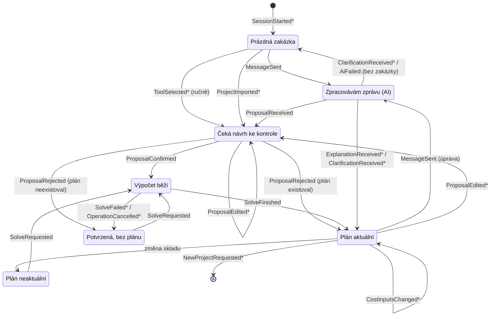

| Stav | Krok na pracovní ploše | Plán | Hlavní akce |
|---|---|---|---|
| Prázdná zakázka | Zadání | — | Odeslat zadání / Zadat ručně |
| Zpracovávám zprávu | beze změny, průběh v Panelu Dialog | beze změny | Zrušit |
| Čeká návrh ke kontrole | Kontrola údajů | pokud existuje, je **neaktuální** (R3) | Potvrdit a vypočítat |
| Potvrzená, bez plánu | Plán a cena (prázdný stav s vysvětlením) | — | Vypočítat |
| Výpočet běží | Plán a cena (načítání) | předchozí neaktuální | Zrušit |
| Plán aktuální | Plán a cena | aktuální | Upravit, Uložit zakázku, Stáhnout PDF |
| Plán neaktuální | Plán a cena | neaktuální | Přepočítat |

Stav „Čeká návrh ke kontrole“ nad existujícím plánem je v diagramu stejný uzel jako u nové zakázky. Liší se jen tím, že souhrn změn má s čím porovnávat.

---

## F1: Hlavní tok

Tok, který prochází end-to-end test (spec. kap. 9, „UI – hlavní tok“) a scénář obhajoby.

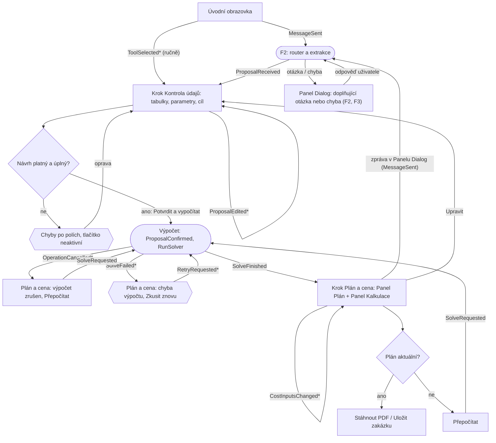

| # | Krok | Obrazovka / panel | Rozhodnutí | Prázdný / chybový stav | Události |
|---|---|---|---|---|---|
| 1 | Zadání | Úvodní obrazovka nebo Krok Zadání | text, nebo karta nástroje | prázdné pole s ukázkami zadání; „Odeslat“ neaktivní, dokud je pole prázdné | `MessageSent`, `ToolSelected`* |
| 2 | Rozpoznání a extrakce | Panel Dialog (průběh), Pracovní plocha beze změny | router: typ a záměr (F2) | nejasné → otázka; chyba AI → F3 | `RoutingDecided`*, `ProposalReceived` |
| 3 | Kontrola | Krok Kontrola údajů | je návrh platný a úplný? cíl „nejnižší cena“ má všechny ceny? | chyby po polích, seznam chyb nad tabulkou; nepotvrzené hodnoty označené | `ProposalEdited`* |
| 4 | Potvrzení | Krok Kontrola údajů | — | — | `ProposalConfirmed` |
| 5 | Výpočet | Krok Plán a cena, Panel Plán (načítání, „Zrušit“) | — | zrušení, chyba solveru | `SolveRequested`, `SolveFinished`, `SolveFailed`*, `OperationCancelled`* |
| 6 | Plán a cena | Panel Plán, Panel Kalkulace | stav řešení: optimální / nejlepší nalezené / částečný / bez řešení | částečný: seznam neumístěných kusů; kalkulace: „chybí cena“ | `CostInputsChanged`* |
| 7 | Úprava dialogem | Panel Dialog → Krok Kontrola údajů se souhrnem změn | potvrdit / upravit / zahodit | plán viditelně neaktuální, PDF neaktivní | `MessageSent`, `ProposalReceived`, `ProposalRejected` |
| 8 | Přepočet | jako krok 4–6 | — | — | `ProposalConfirmed`, `SolveFinished` |
| 9 | Export | Panel Plán / Hlavička zakázky | je plán aktuální? | neaktuální: „Stáhnout PDF“ neaktivní s vysvětlením | `PdfRequested`*, `PdfRendered`* |

**Ukazatel kroků** v hlavičce ukazuje Zadání → Kontrola údajů → Plán a cena. Hotové kroky jsou klikací. Když čeká návrh, krok Plán a cena má štítek „neaktuální“, ale lze se na něj podívat.

---

## F2: Zpracování zprávy v dialogu

Co se stane po odeslání libovolné zprávy v Panelu Dialog. Rozhodování o záměru dělá aplikační logika podle `RoutingDecision`, ne frontend.

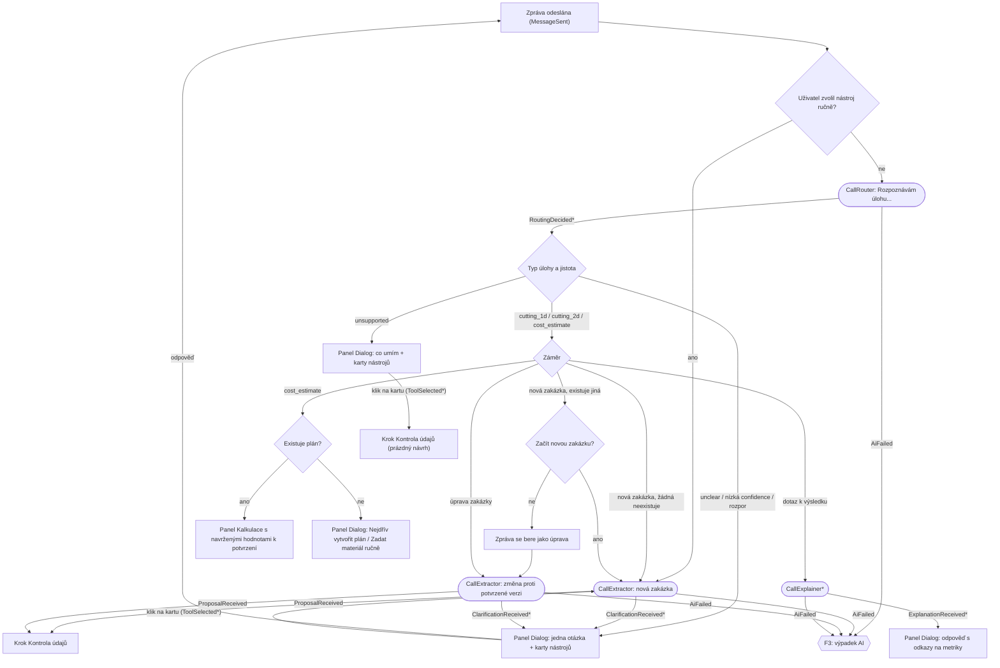

| Rozhodovací bod | Kdo rozhoduje | Poznámka |
|---|---|---|
| Nástroj zvolený ručně | uživatel | má přednost před routerem (spec. kap. 6) |
| Typ úlohy a jistota | router + práh v aplikační logice | práh z evaluace; confidence nenahrazuje validaci |
| Záměr | router (samostatná otázka) | nová zakázka / úprava / dotaz k výsledku |
| Začít novou zakázku? | uživatel | chrání rozpracovanou zakázku (UC-15 A1) |
| Existuje plán? | aplikační logika | pro `cost_estimate` (UC-04 A2) |

**Stavy Panelu Dialog během toku:** načítání má text podle fáze („Rozpoznávám úlohu…“, „Připravuji údaje ke kontrole…“, „Hledám odpověď…“) a tlačítko „Zrušit“ (`OperationCancelled`*). Pole pro zprávu zůstává editovatelné, ale odeslání čeká na dokončení. Prázdný Panel Dialog na začátku zakázky ukazuje 2–3 ukázky zpráv, nad plánem ukázky úprav („Přidej…“, „Změň délku…“).

---

## F3: Výpadek AI

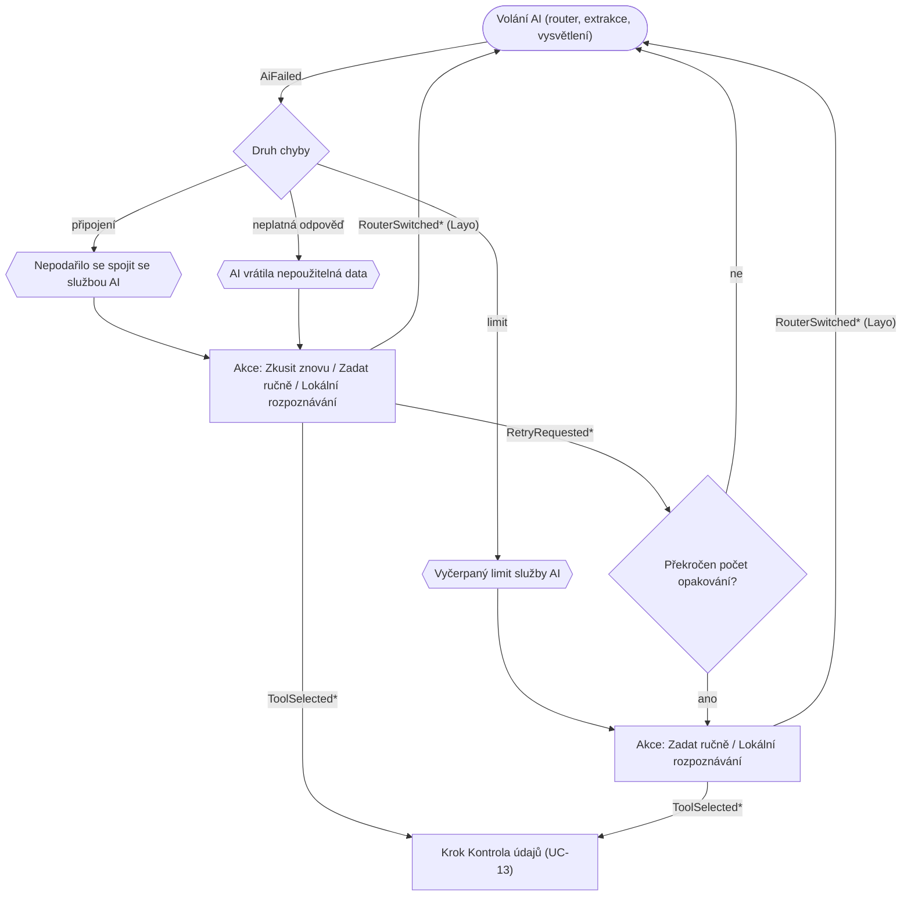

- Text zprávy se po chybě vrátí do pole a nic se neztratí. Potvrzená zakázka a rozpracovaný návrh se nemění.
- „Lokální rozpoznávání“ se nabízí, jen když je Layo dostupné. Pomáhá jen s výběrem nástroje. Extrakce potřebuje generativní model, takže po přepnutí na Layo aplikace otevře ruční Kontrolu údajů s předvoleným nástrojem.
- Chyba se zobrazuje jako zpráva v Panelu Dialog (ne jako toast), aby zůstala v historii a nesla akce.

---

## F4: Vstupy do aplikace

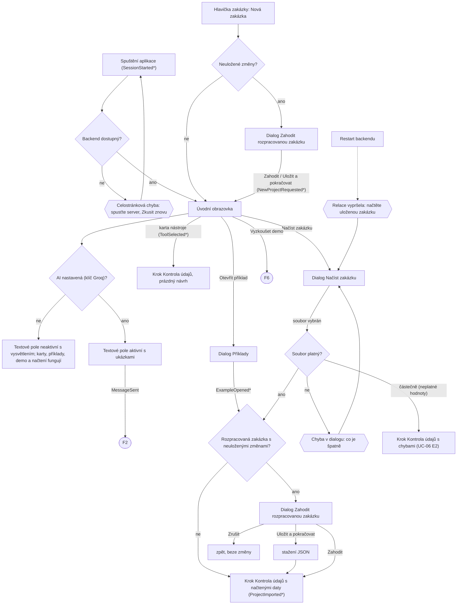

| Vstup | Výsledný krok | Plán spočítán? | Poznámka |
|---|---|---|---|
| Text | Kontrola údajů (po AI) | ne | UC-01 |
| Karta nástroje | Kontrola údajů, prázdný návrh | ne | UC-13 |
| Příklad | Kontrola údajů, štítek „Příklad“ | ne | UC-10 |
| Načtení souboru | Kontrola údajů | ne | UC-06; chyba souboru zůstává v dialogu |
| Demo | Krok Zadání, předvyplněný text | ne | UC-11 |

Návrat na Úvodní obrazovku logem v hlavičce zakázku neruší. Úvod pak nabídne „Pokračovat v zakázce“ (UC-09 A3).

---

## F5: Kalkulace

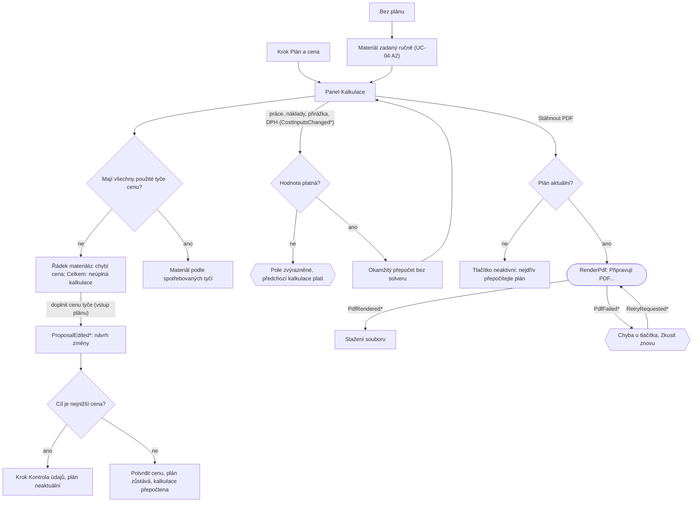

- Doplnění ceny tyče v Panelu Kalkulace je pohodlná zkratka, ale cena tyče je vstup plánu (R2). Vznikne proto návrh změny. Při cíli „nejnižší cena“ to znamená návrat do Kontroly údajů (R4), jinak stačí potvrdit cenu přímo v panelu („Potvrdit cenu“), vznikne nová verze a přepočítá se jen kalkulace. Plán zůstává aktuální, protože cena tyče při jiném cíli plán neovlivňuje. (Rozhodnuto při service designu: podle cíle, ne vždy přes Kontrolu údajů.)
- Prázdný stav Panelu Kalkulace bez plánu: „Kalkulace se spočítá z plánu“ s akcí „Zadat materiál ručně“ (UC-04 A2).

---

## F6: Demo režim

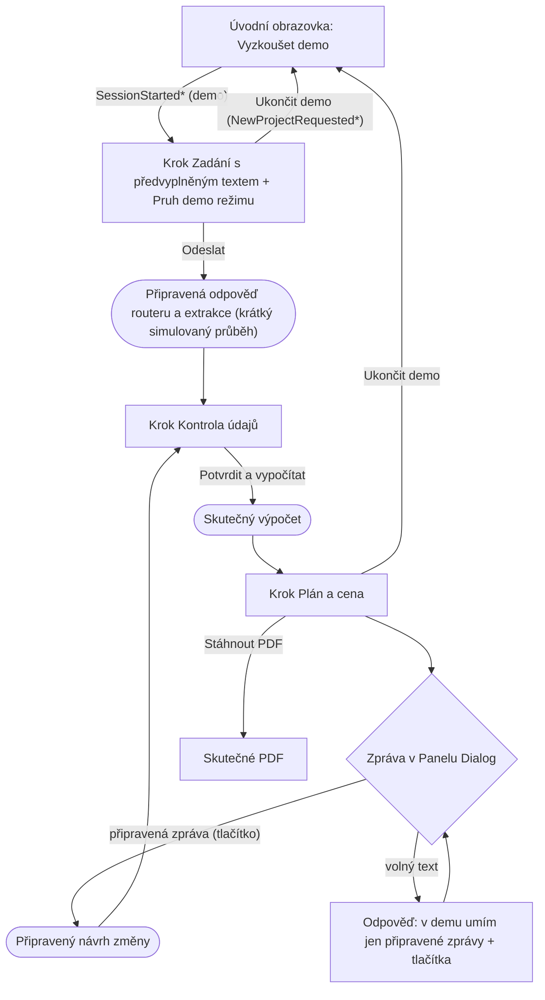

Pruh demo režimu je viditelný na všech krocích a ve Vývojářském panelu (router „demo“). Výpočet, kalkulace a PDF nejsou simulované.

---

## F7: Vývojářský panel

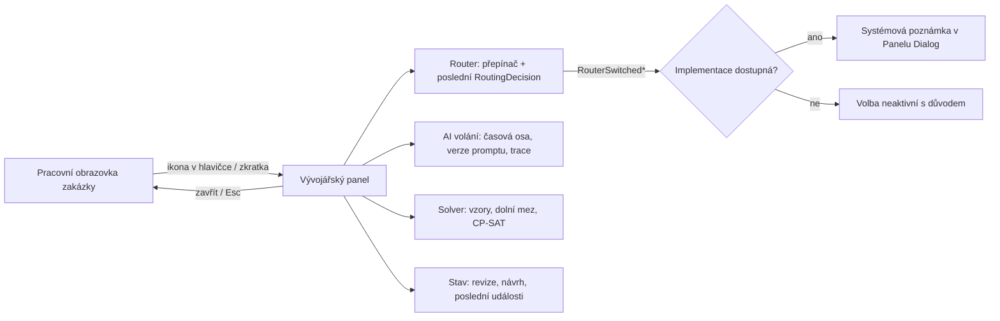

Prázdné stavy záložek: „Zatím žádné rozhodnutí routeru“, „Zatím žádné volání AI“, „Zatím žádný výpočet“. Když je Langfuse vypnutý, záložka AI volání to uvádí a odkazy na trace chybí.

---

## F8: Řezání desek *(rozšíření)*

Tok je F1 s rozdíly jen v Kontrole údajů a v Panelu Plán:

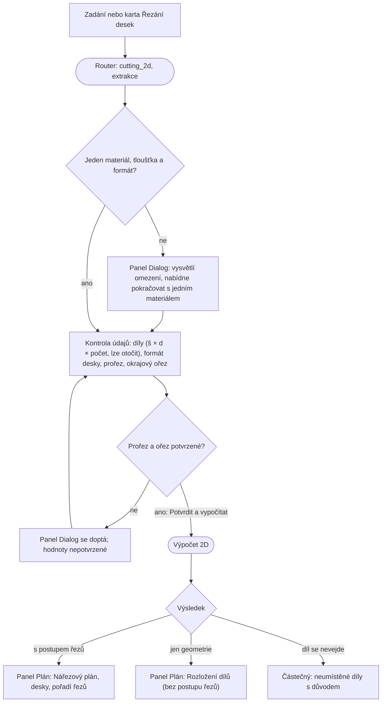

---

## F9: Sklad v zakázce *(rozšíření)*

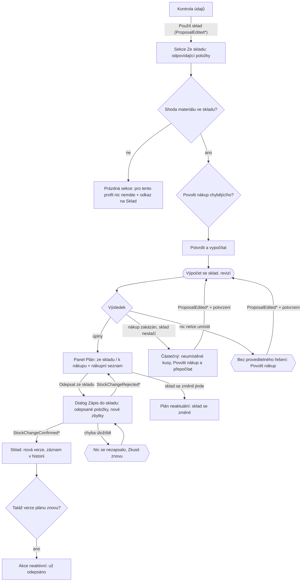

---

## F10: Správa skladu *(rozšíření)*

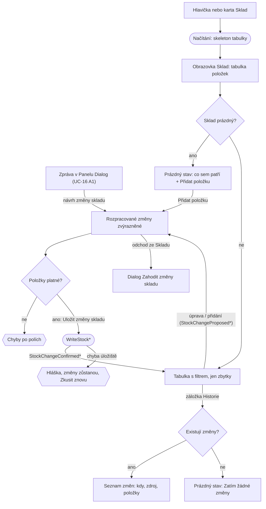
