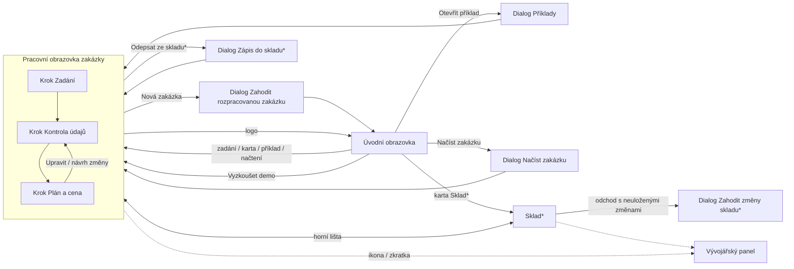

# Mapa obrazovek

**Stav:** schváleno  
**Vychází z:** [02-use-cases.md](02-use-cases.md), [03-user-flows.md](03-user-flows.md), specifikace v0.3 kap. 4, skill `ui-frontend`

Dokument je inventář všeho, co uživatel vidí. Názvy odpovídají [slovníku](README.md#slovník-obrazovek-a-panelů). U každé položky je účel, obsah a data z view modelu, akce (s událostí reduceru), odchozí přechody a pět stavů ze skillu `ui-frontend`: **prázdný · načítání · chyba · neaktuální · hotovo**. Kde stav nedává smysl, je uvedeno „—“.

Data jsou uvedená jako pole view modelu. Kostra view modelu je na konci a je to návrh pro M1, ne závazné API.

## Rozvržení

**Široká obrazovka (od 1280 px)**

```
┌──────────────────────────────────────────────────────────────────────┐
│ Horní lišta: DecisionEngine · Zakázka · Sklad*        [⚙ vývojář]    │
├──────────────────────────────────────────────────────────────────────┤
│ [Pruh demo režimu — jen v demu]                                      │
├──────────────────────────────────────────────────────────────────────┤
│ Hlavička zakázky: název · Zadání → Kontrola údajů → Plán a cena ·    │
│                   Uložit · Načíst · Nová zakázka                     │
├─────────────────────┬────────────────────────────────────────────────┤
│ Panel Dialog        │ Pracovní plocha                                │
│ (~360 px, sbalit ◂) │  Krok Zadání | Krok Kontrola údajů |           │
│                     │  Krok Plán a cena:                             │
│ zprávy              │    Panel Plán                                  │
│ …                   │    Panel Kalkulace                             │
│ [pole pro zprávu]   │  ─ Souhrnná lišta (připnutá dole) ─            │
└─────────────────────┴────────────────────────────────────────────────┘
                                         Vývojářský panel ▸ (vysouvací)
```

**Střední šířka (768–1279 px):** Panel Dialog se změní na vysouvací panel vlevo, otevírá se tlačítkem „Dialog“ v Hlavičce zakázky. Odznak na tlačítku ukazuje nepřečtenou odpověď nebo otázku. Pracovní plocha má celou šířku. Ukazatel kroků se zkrátí na čísla s názvem aktivního kroku.

**Pod 768 px:** není cílová šířka (spec. kap. 4). Panely se řadí pod sebe bez záruky pohodlí.

## Navigační diagram



`*` = rozšíření sklad. Řezání desek (UC-02) nemá vlastní obrazovku. Mění jen obsah kroků Kontrola údajů a Plán a cena.

---

## Obrazovky

### Úvodní obrazovka (`HomeScreen`, `/`)

**Účel:** Za pár sekund vysvětlit, co aplikace dělá, a nabídnout všechny způsoby, jak začít (UC-09).

**Obsah a data**
- Název a podtitul „Ze zadání k nářezovému plánu a ceně zakázky.“
- Velké textové pole s ukázkami zadání (střídají se, klik ukázku vloží) — `home.example_prompts[]`, `session.ai.extraction_available`.
- Karty nástrojů: „Řezání tyčí“, „Kalkulace“, případně „Řezání desek“ a „Sklad“ — `capabilities[]` (jen implementované).
- Akce „Načíst zakázku“, „Otevřít příklad“, „Vyzkoušet demo“.
- Pokud relace má rozpracovanou zakázku: karta „Pokračovat v zakázce ‚název‘“ — `project.name`, `project.has_content`.

**Akce:** Odeslat zadání (`MessageSent`) · karta nástroje (`ToolSelected`*) · Otevřít příklad · Načíst zakázku · Vyzkoušet demo (`SessionStarted`* demo) · Pokračovat v zakázce.

**Přechody:** → Pracovní obrazovka zakázky (Krok Zadání s průběhem / Krok Kontrola údajů) · → Dialog Příklady · → Dialog Načíst zakázku · → Sklad*.

| Stav | Co uživatel vidí |
|---|---|
| prázdný | výchozí podoba: pole s ukázkou, karty a tři akce |
| načítání | po odeslání aplikace hned přejde na Pracovní obrazovku, kde je průběh v Panelu Dialog; úvod sám nečeká |
| chyba | backend nedostupný: celostránková chyba s příkazem ke spuštění a „Zkusit znovu“; AI nenastavená: pole neaktivní s vysvětlením a odkazem na ruční zadání a demo |
| neaktuální | — |
| hotovo | — (obrazovka je rozcestník) |

### Pracovní obrazovka zakázky (`ProjectScreen`, `/project`)

**Účel:** Celá práce na jedné zakázce: Panel Dialog vlevo, Pracovní plocha vpravo, krok podle stavu zakázky (F0).

**Skládá se z:** Horní lišta · (Pruh demo režimu) · Hlavička zakázky · Panel Dialog · Pracovní plocha (Krok Zadání / Kontrola údajů / Plán a cena) · Souhrnná lišta (jen v kroku Plán a cena) · Vývojářský panel (skrytý).

**Data:** `project.step` (odvozený krok z F0), `pending_operation`.

**Přechody:** logo → Úvodní obrazovka (zakázka se neruší) · Sklad* · dialogy viz níže.

Stavy jsou definované na úrovni panelů.

### Sklad (`StockScreen`, `/stock`) *(rozšíření)*

**Účel:** Evidence materiálu a zbytků (UC-16).

**Obsah a data**
- Záložky **Položky** a **Historie**.
- Položky: tabulka (materiál/profil, délka, počet, cena za kus, zbytek, původ) — `stock.items[]` se stavem řádku (`unchanged|added|changed|removed`) a chybami polí. Filtr materiálu a přepínač „jen zbytky“.
- Lišta rozpracovaných změn: „3 neuložené změny · Uložit změny skladu · Zahodit“.
- Historie: seznam `StockChange` (kdy, zdroj: ruční úprava / zakázka X verze N, položky) — `stock.history[]`.
- Verze skladu — `stock.revision` (jen ve Vývojářském panelu jako číslo, v UI „poslední změna 23. 11. 14:02“).

**Akce:** Přidat položku · upravit buňku · smazat řádek (`StockChangeProposed`*) · Uložit změny skladu (`StockChangeConfirmed`*) · Zahodit (`StockChangeRejected`*).

**Přechody:** → Pracovní obrazovka (horní lišta) · → Dialog Zahodit změny skladu.

| Stav | Co uživatel vidí |
|---|---|
| prázdný | „Sklad je prázdný. Zapište tyče a zbytky, které máte v dílně, a výpočet je použije jako první.“ + Přidat položku |
| načítání | skeleton tabulky při načtení; u ukládání průběh na tlačítku |
| chyba | chyby po polích; úložiště nedostupné: pruh nad tabulkou s „Zkusit znovu“, změny zůstávají |
| neaktuální | — (sklad je zdroj pravdy) |
| hotovo | tabulka bez rozpracovaných změn, toast „Sklad uložen“ |

---

## Části obrazovky

### Horní lišta (`AppBar`)

**Obsah:** logo DecisionEngine (→ úvod), odkazy Zakázka a Sklad* (aktivní zvýrazněný), ikona Vývojářského panelu. **Data:** `capabilities[]`, `session.mode`. **Stavy:** jen hotovo. Odkaz Zakázka je neaktivní, dokud relace nemá zakázku.

### Pruh demo režimu (`DemoBanner`)

**Obsah:** „Demo: odpovědi AI jsou předem připravené, výpočty jsou skutečné.“ + Ukončit demo (`NewProjectRequested`*). Při zapnutém Layo: „rozpoznání úlohy: lokální model“. **Data:** `session.mode`, `session.ai.router_impl`. Nelze ho skrýt.

### Hlavička zakázky (`ProjectHeader`)

**Účel:** Kde jsem, jak se zakázka jmenuje a co s ní můžu dělat.

**Obsah a data**
- Název zakázky (editovatelný inline; výchozí z extrakce, jinak „Nová zakázka“) — `project.name`.
- Štítky: „Příklad“, „neuloženo“ — `project.is_example`, `project.unsaved_changes`.
- Nástroj běžným názvem („Řezání tyčí“) — `project.tool_label`.
- **Ukazatel kroků** (`StepIndicator`): Zadání → Kontrola údajů → Plán a cena. Stav kroku je hotový / aktivní / nedostupný / „neaktuální“ — `project.steps[]`. Hotové kroky jsou klikací.
- Akce: Uložit zakázku · Načíst zakázku · Nová zakázka · (na střední šířce) Dialog.

**Akce:** přejmenovat (`ProjectRenamed`* — drobná událost mimo revize vstupů) · klik na krok (jen zobrazení, bez události) · Uložit (stažení JSON) · Načíst (→ Dialog Načíst zakázku) · Nová zakázka (→ F4).

| Stav | Co uživatel vidí |
|---|---|
| prázdný | „Nová zakázka“, aktivní krok Zadání, Uložit neaktivní (není co uložit) |
| načítání | — (průběh je v panelech) |
| chyba | — |
| neaktuální | krok Plán a cena se štítkem „neaktuální“ |
| hotovo | všechny kroky hotové, štítek „neuloženo“ podle potřeby |

### Souhrnná lišta (`ResultSummaryBar`)

**Účel:** I při scrollování mít na očích výsledek a hlavní akce (krok Plán a cena).

**Obsah a data:** štítek stavu řešení, počet tyčí, výtěžnost, cena celkem (nebo „neúplná“) — `result.status`, `result.metrics.bars_used`, `result.metrics.yield`, `cost.total`, `cost.complete`. Akce: Přepočítat (jen když je plán neaktuální, výrazná) · Stáhnout PDF · Uložit zakázku.

| Stav | Co uživatel vidí |
|---|---|
| prázdný | skrytá (mimo krok Plán a cena) |
| načítání | „Počítám plán…“ + Zrušit; při PDF průběh na tlačítku |
| chyba | „Výpočet se nezdařil“ + Zkusit znovu |
| neaktuální | šedý souhrn s přeškrtnutou cenou, výrazné „Přepočítat“ nebo „Zkontrolovat změny“ (čeká-li návrh), PDF neaktivní s tooltipem |
| hotovo | štítek, čísla, aktivní akce |

---

## Panely

### Panel Dialog (`ChatPanel`)

**Účel:** Zadávání a úpravy přirozeným jazykem, otázky aplikace a lidsky popsané chyby AI (UC-01, 03, 05, 07, 14).

**Obsah a data**
- Seznam zpráv — `messages[]`: `role` (`user|assistant|system`), `kind` (`text|question|proposal_summary|error|explanation|system_note`), `text`, `actions[]` (tlačítka: volby otázky, Zkusit znovu, Zadat ručně, karty nástrojů), `metric_refs[]` (odkazy do Panelu Plán).
- Indikátor průběhu s fází a Zrušit — `pending_operation.kind`, `pending_operation.label`, `pending_operation.cancellable`.
- Pole pro zprávu (víceřádkové, Enter odešle, Shift+Enter nový řádek) a navržené zprávy jako čipy podle stavu — `chat.suggestions[]`.
- Tlačítko sbalit (široká obrazovka).

**Akce:** Odeslat (`MessageSent`) · klik na volbu / čip (`MessageSent` s textem, případně `ToolSelected`*) · Zrušit (`OperationCancelled`*) · Zkusit znovu (`RetryRequested`*) · odkaz na metriku (vizuální zvýraznění v Panelu Plán, bez události).

**Přechody:** návrh → Krok Kontrola údajů (R4) · ruční zadání → Krok Kontrola údajů.

| Stav | Co uživatel vidí |
|---|---|
| prázdný | uvítání podle kroku: na začátku „Popište, co potřebujete nařezat…“ + 2–3 čipy s ukázkami; nad plánem čipy úprav („Přidej…“, „Změň délku…“, „Proč…?“) |
| načítání | bublina s fází („Rozpoznávám úlohu…“, „Připravuji údaje ke kontrole…“, „Hledám odpověď…“) a Zrušit; pole editovatelné, odeslání čeká |
| chyba | chybová zpráva podle druhu (připojení / limit / neplatná odpověď) s akcemi (F3); text vrácen do pole |
| neaktuální | — (historie zpráv se nezastarává; vysvětlení k neaktuálnímu plánu nese poznámku) |
| hotovo | poslední zpráva aplikace, případně souhrn změn s odkazem „Zobrazit v kontrole“ |

**Sbalený stav:** úzký pruh s ikonou a odznakem nepřečtené zprávy. Otevře se klávesou nebo klikem.

### Krok Zadání (`InputStep`)

**Účel:** Začít zakázku, když nevznikla z úvodu (nová zakázka, demo, návrat).

**Obsah a data:** velké pole (stejné jako na úvodu; v demu předvyplněné) — `input.draft_text`, `session.mode`; karty nástrojů; odkaz „Zadat ručně“.

**Akce:** Odeslat (`MessageSent`) · karta / Zadat ručně (`ToolSelected`*).

| Stav | Co uživatel vidí |
|---|---|
| prázdný | pole s ukázkou zadání, karty |
| načítání | pole zamčené s textem zprávy, průběh je v Panelu Dialog |
| chyba | AI nenastavená: jako na úvodu; chyba volání: text zůstává v poli, akce v Panelu Dialog |
| neaktuální | — |
| hotovo | — (po návrhu se plocha přepne na Kontrolu údajů) |

### Krok Kontrola údajů (`ReviewStep`)

**Účel:** Zkontrolovat a opravit návrh a výslovně potvrdit vstupy plánu (R1, R4, R6).

**Obsah a data**
- **Souhrn změn** (jen u úpravy existující zakázky): „+ 2× příčka 850 mm · délka sloupku 2000 → 2200 mm“ — `proposal.change_summary[]`, `proposal.base_revision`.
- **Seznam chyb** nad tabulkami s odkazy na pole — `proposal.errors[]` (`field_path`, `message`).
- **Tabulka dílů** (1D): název, délka (mm), počet; u 2D šířka, délka, počet, lze otočit — `proposal.parts[]`. Každá buňka má `value`, `status` (`confirmed|unconfirmed|changed`), `origin` (`user|model|default`), `previous` a `error`. Řádek má stav `added|removed|unchanged|changed`.
- **Tabulka skladových délek / formát desky:** délka (rozměry), cena za kus (volitelná) — `proposal.stock_formats[]`.
- **Parametry:** prořez, zarovnávací ořez, minimální využitelný zbytek, časový limit (pod „Další nastavení“); u 2D okrajový ořez — `proposal.parameters`.
- **Cíl optimalizace:** tři volby s krátkým vysvětlením; neaktivní volba má důvod („chybí ceny“) — `proposal.objective`, `proposal.objective_options[]`.
- **Sekce Ze skladu*:** přepínač Použít sklad, Povolit nákup, odpovídající položky — `proposal.stock_usage`.
- **Akce:** Potvrdit a vypočítat (hlavní) · Zahodit změny (jen u úpravy) · Přidat díl.

**Akce:** úprava buňky / řádku / parametru / cíle (`ProposalEdited`*) · Potvrdit a vypočítat (`ProposalConfirmed`) · Zahodit změny (`ProposalRejected`). Klávesnice: Tab a Shift+Tab mezi buňkami, Enter na posledním řádku přidá řádek, Ctrl+Enter potvrdí. Vložení více řádků ze schránky (UC-13 A1).

**Přechody:** Potvrdit → Krok Plán a cena (načítání) · Zahodit → předchozí krok.

| Stav | Co uživatel vidí |
|---|---|
| prázdný | ruční zadání: tabulka s jedním prázdným řádkem a fokusem, výchozí parametry označené jako nepotvrzené, nápověda „Napište díly sem, nebo je popište v dialogu vlevo“ |
| načítání | během AI úpravy návrhu (další zpráva) překryv tabulky „Aktualizuji návrh…“; editace zamčená |
| chyba | chybná pole zvýrazněná ikonou a textem, seznam chyb nahoře, Potvrdit neaktivní s důvodem („Opravte 2 pole“); u cíle „nejnižší cena“ bez cen zvýrazněná pole cen + volba „zvolit jiný cíl“ |
| neaktuální | — (návrh je vždy aktuální vůči sobě); pokud se mezitím změnil sklad*, poznámka v sekci Ze skladu |
| hotovo | platný návrh, nepotvrzené hodnoty stále označené (potvrdí se spolu s návrhem), Potvrdit aktivní |

**Značení hodnot:** nepotvrzená hodnota = tečkované podtržení + ikona „?“ + tooltip („Výchozí hodnota, ověřte“ / „Odhad AI z textu ‚šestimetrové‘“). Změněná hodnota = podbarvení + původní hodnota přeškrtnutá. Nový řádek = značka „nový“. Smazaný řádek = přeškrtnutý s „Vrátit“. Nikdy ne jen barvou.

### Panel Plán (`PlanPanel`)

**Účel:** Ukázat výsledek výpočtu tak, aby šel ověřit a použít u pily (UC-01, 02, 08).

**Obsah a data**
- **Štítek stavu řešení:** Optimální / Nejlepší nalezený (o kolik od dolní meze) / Částečný / Bez řešení — ikona a text, tooltip s vysvětlením — `result.status`, `result.gap_text`.
- **Metriky:** spotřebované tyče (podle délek), délka dílů, odpad, využitelné zbytky, výtěžnost; u skladu* rozdělení ze skladu / k nákupu — `result.metrics`.
- **Měřítkový plán:** SVG z backendu (`result.svg`) s popisky dílů a pořadím na tyči, legendou (díl, prořez, zbytek, odpad) a stejné tyče seskupené („3× stejné řezání“). Najetí nebo fokus na díl zvýrazní všechny jeho výskyty a řádek v rozpisu. U 2D desky s číslovaným pořadím řezů. Nadpis „Nářezový plán“, nebo „Rozložení dílů“.
- **Rozpis:** tabulka tyč → díly (textová alternativa plánu) — `result.bars[]`.
- **Neumístěné kusy** (u částečného) s důvodem — `result.unplaced[]`.
- **Nákupní seznam*:** „k nákupu: 4× 6000 mm“ — `result.purchase[]`.
- Akce: Upravit (→ Kontrola údajů) · Odepsat ze skladu* (→ Dialog Zápis do skladu).

**Akce:** Upravit (zobrazení kroku Kontrola, editace vytvoří `ProposalEdited`*) · Přepočítat (`SolveRequested`) · Zrušit (`OperationCancelled`*) · Odepsat ze skladu* (`StockChangeProposed`*).

| Stav | Co uživatel vidí |
|---|---|
| prázdný | potvrzená zakázka bez plánu (např. po zrušení): „Plán zatím není spočítaný“ + Vypočítat |
| načítání | „Počítám plán…“ s časovým údajem vůči limitu (pruh 0–10 s), Zrušit; předchozí plán ztlumený v pozadí, pokud existuje |
| chyba | „Výpočet se nezdařil. Zkuste to znovu; pokud chyba trvá, upravte zadání.“ + Zkusit znovu; detail jen ve Vývojářském panelu |
| neaktuální | plán ztlumený s pruhem „Neaktuální: od výpočtu se změnily díly“ (důvod z `result.stale_reason`: návrh čeká / vstupy změněny / sklad změněn) + Přepočítat nebo Zkontrolovat změny; PDF neaktivní |
| hotovo | štítek, metriky, plán, rozpis; u částečného výrazný blok neumístěných kusů nad plánem (nepůsobí jako hotová zakázka) |

### Panel Kalkulace (`CostPanel`)

**Účel:** Orientační náklady s dohledatelným původem každé částky (UC-04).

**Obsah a data**
- **Materiál:** řádky podle spotřebovaných tyčí (délka × počet × cena = částka; zdroj nákup / sklad*) — `cost.material_lines[]`; chybějící cena jako „chybí cena“ s polem k doplnění.
- **Práce:** hodiny × sazba — `cost.inputs.labor_hours`, `cost.inputs.hourly_rate`.
- **Další náklady:** seznam položka + částka — `cost.inputs.extra_costs[]`.
- **Přirážka k nákladům (%)** a **DPH (%)** — `cost.inputs.markup_pct`, `cost.inputs.vat_pct`.
- **Souhrn:** náklady, přirážka, základ, DPH, celkem — `cost.totals`, `cost.complete`.
- **Cenové předpoklady** a **chybějící položky** — `cost.assumptions[]`, `cost.missing[]`.
- Přepínač „Nezapočítávat materiál ze skladu“* — `cost.inputs.exclude_stock`.
- Bez plánu: tabulka ručních položek materiálu (UC-04 A2) — `cost.manual_material[]`.

**Akce:** změna vstupu kalkulace (`CostInputsChanged`*, přepočet do 100 ms) · doplnění ceny tyče (`ProposalEdited`*, podle cíle buď Kontrola údajů, nebo „Potvrdit cenu“ přímo — F5).

| Stav | Co uživatel vidí |
|---|---|
| prázdný | bez plánu: „Kalkulace se spočítá z plánu“ + Zadat materiál ručně; s plánem bez vstupů práce: materiál spočítaný, práce „nezadáno“ (ne 0 Kč) |
| načítání | — (přepočet je okamžitý); při běžícím výpočtu plánu ztlumený s „čeká na plán“ |
| chyba | neplatná hodnota: pole zvýrazněné, předchozí platná částka zůstává |
| neaktuální | jako Panel Plán: ztlumené částky materiálu s poznámkou „materiál podle předchozího plánu“; vstupy práce lze upravovat dál |
| hotovo | rozpad, celkem; neúplná kalkulace má výrazný štítek „Neúplná: chybí cena tyče 3000 mm“ |

### Vývojářský panel (`DevPanel`)

**Účel:** Diagnostika a přepínání routeru (UC-12). Pro S1 a S2, mimo hlavní tok.

**Obsah a data:** záložky Router (přepínač, `dev.routing_decision`, pravděpodobnosti jako pruhy, práh), AI volání (`dev.ai_calls[]`: role, model, verze promptu, latence, tokeny, validace, odkaz na trace), Solver (`dev.solver`: vzory, dolní mez, CP-SAT, čas), Stav (`dev.revisions`, `dev.events[]`). Poznámka „trasování vypnuto“, pokud Langfuse chybí.

**Akce:** přepnout router (`RouterSwitched`*) · zavřít (Esc).

| Stav | Co uživatel vidí |
|---|---|
| prázdný | per záložka: „Zatím žádné rozhodnutí routeru / volání AI / výpočet“ |
| načítání | běžící volání v časové ose s indikátorem |
| chyba | chybové volání v časové ose červeně s ikonou a textem chyby (bez klíčů) |
| neaktuální | — |
| hotovo | data posledních operací |

---

## Dialogy

| Dialog | Účel | Obsah a data | Akce (události) | Stavy |
|---|---|---|---|---|
| **Dialog Příklady** (`ExamplesDialog`) | Vybrat připravenou zakázku (UC-10) | seznam příkladů s názvem, jednou větou a nástrojem — `examples[]` (jen implementované nástroje) | vybrat (`ExampleOpened`*) · zavřít | načítání: skeleton seznamu; chyba: „Příklady se nepodařilo načíst“ + Zkusit znovu; prázdný: nemá nastat (příklady jsou součástí aplikace) |
| **Dialog Načíst zakázku** (`ImportDialog`) | Načíst JSON (UC-06) | oblast pro přetažení + výběr souboru; po chybě konkrétní hláška | vybrat soubor (`ProjectImported`*) · zavřít | načítání: „Kontroluji soubor…“; chyba: co je špatně a jak dál, dialog zůstává otevřený; hotovo: dialog se zavře a plocha ukáže Kontrolu údajů |
| **Dialog Zahodit rozpracovanou zakázku** (`DiscardProjectDialog`) | Neztratit práci omylem (UC-15) | název zakázky, co by se ztratilo (návrh / neuložená verze) | Uložit a pokračovat · Zahodit (`NewProjectRequested`* / pokračování importu) · Zrušit | jen hotovo; fokus na Zrušit |
| **Dialog Zápis do skladu*** (`StockWriteDialog`) | Odepsat spotřebu a zapsat zbytky (UC-08) | tabulka odepisovaných položek a nových zbytků (upravitelné, zaškrtávací) — `stock_write.proposal` | Zapsat do skladu (`StockChangeConfirmed`*) · Zrušit (`StockChangeRejected`*) | načítání: průběh na tlačítku; chyba: hláška + Zkusit znovu, nic se nezapsalo; prázdný: „Plán nevytváří žádné využitelné zbytky“ (odpis spotřeby zůstává) |
| **Dialog Zahodit změny skladu*** (`DiscardStockDialog`) | Neztratit rozpracované změny skladu | počet neuložených změn | Uložit · Zahodit · Zrušit | jen hotovo |

Všechny dialogy: fokus se při otevření přesune do dialogu a při zavření vrátí. Esc = Zrušit. Destruktivní akce nikdy není výchozí.

## Celostránkové stavy

| Stav | Kde | Obsah |
|---|---|---|
| Backend nedostupný | kdekoli | „Aplikace se nemůže spojit se svým serverem. Spusťte `uv run decision-engine`.“ + Zkusit znovu |
| Relace vypršela (restart backendu) | Pracovní obrazovka | „Server byl restartován a rozpracovaná zakázka se ztratila. Pokud jste ji uložili, načtěte ji.“ + Načíst zakázku / Na úvod |

Druhý stav vyplývá z toho, že relace je jen v paměti (spec. kap. 7). *Ke zvážení po semestru:* automatické ukládání rozpracované zakázky.

---

## Kostra view modelu (návrh pro M1)

Struktura, kterou backend posílá po každé události. Klíče jsou anglicky. Hodnoty pro zobrazení (popisky, odvozené stavy) počítá backend a frontend jen formátuje čísla a jednotky.

```
ViewModel
├── session: mode (normal|demo), ai { extraction_available, router_impl, routers_available[] }
├── capabilities[]: id, label, available
├── project: name, tool_label, revision, is_example, unsaved_changes, has_content, step, steps[]
├── pending_operation?: kind (routing|extraction|explanation|solving|pdf|import|stock_write), label, cancellable, started_at
├── messages[]: id, role, kind, text, actions[], metric_refs[]
├── chat: suggestions[]
├── proposal?: base_revision, change_summary[], errors[], parts[], stock_formats[], parameters, objective, objective_options[], stock_usage?
├── result?: status, gap_text, stale, stale_reason, svg, metrics, bars[], unplaced[], purchase[]
├── cost?: material_lines[], inputs, totals, complete, assumptions[], missing[], manual_material[]
├── stock?*: revision, items[], pending_changes, history[]
└── dev?: routing_decision, ai_calls[], solver, revisions, events[]
```

Odvozené a nikde neukládané: `project.step`, `result.stale`, `result.stale_reason`, `project.unsaved_changes`, `cost.complete` (R3, ADR-0006).

## Pokrytí use cases

| UC | Obrazovky a panely |
|---|---|
| 01 | Úvodní obrazovka, Panel Dialog, Kontrola údajů, Panel Plán, Panel Kalkulace, Souhrnná lišta |
| 02* | Kontrola údajů (varianta 2D), Panel Plán (desky) |
| 03 | Panel Dialog, Kontrola údajů (souhrn změn), Panel Plán (neaktuální) |
| 04 | Panel Kalkulace, Souhrnná lišta |
| 05 | Panel Dialog (otázka, karty nástrojů) |
| 06 | Hlavička zakázky, Dialog Načíst zakázku, Dialog Zahodit rozpracovanou zakázku |
| 07 | Panel Dialog (chyba), Úvodní obrazovka (AI nenastavená), Vývojářský panel |
| 08* | Kontrola údajů (Ze skladu), Panel Plán, Panel Kalkulace, Dialog Zápis do skladu |
| 09 | Úvodní obrazovka, celostránkové stavy |
| 10 | Dialog Příklady, Hlavička zakázky (štítek Příklad) |
| 11 | Pruh demo režimu, Krok Zadání, Panel Dialog (čipy) |
| 12 | Vývojářský panel |
| 13 | Kontrola údajů (prázdný stav) |
| 14 | Panel Dialog (vysvětlení), Panel Plán (zvýraznění metriky) |
| 15 | Hlavička zakázky, Dialog Zahodit rozpracovanou zakázku |
| 16* | Sklad, Dialog Zahodit změny skladu |
