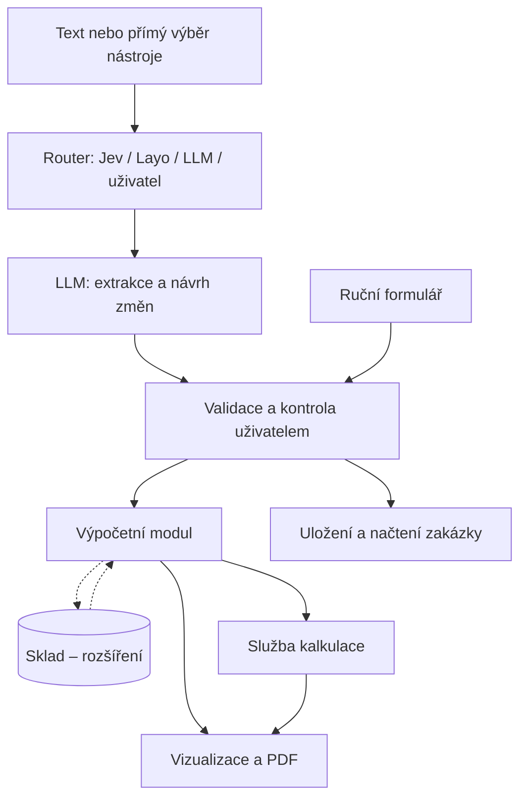

# DecisionEngine — specifikace cílové verze pro semestrální práci

**Verze:** 0.7.0 — opravy po hromadné recenzi  
**Datum:** 24. 11. 2026  
**Stav:** Specifikace budoucího chování; tento dokument nepopisuje dokončenou implementaci.

**Změny oproti 0.6.0:** Horní meze velikosti úlohy a dodržení časového limitu (kap. 8). Prořez a ořez v desetinách mm, odvozování výchozího cíle a potvrzení ručně zapsané hodnoty (UC-01, ADR-0011). První etapa UC-04: orientační cena materiálu u výsledku.

## 1. Produkt a jeho účel

DecisionEngine je webová aplikace pro malé dílny a řemeslníky. Z přirozeného zadání pomůže vytvořit ověřenou zakázku, vybrat vhodný výpočet a získat použitelný výrobní podklad a orientační kalkulaci.

Uživatel může napsat například: „Na plot potřebuji deset jeklů po dvou metrech a pět příček po metru a půl, nakupuji šestimetrové tyče.“ Aplikace rozpozná typ úlohy, připraví údaje ke kontrole, vypočítá nářezový plán a nabídne jeho export. Uživatel může navázat: „Přidej ještě dvě příčky a přepočítej cenu.“ Pokud je zapnutý sklad, může napsat: „Použij nejdřív zbytky ze skladu a zbytek dokup.“

Hlavní přínos: méně ručního přepisování, přehledné plánování materiálu a možnost upravovat zakázku bez opakovaného zadávání všech údajů.

## 2. Cíloví uživatelé

| Uživatel | Potřeba | Typická situace |
|---|---|---|
| Zámečník nebo malá kovodílna | Rozdělit požadované délky do skladových tyčí | Plot, rám, regál, konstrukce |
| Truhlář nebo domácí dílna | Rozmístit pravoúhlé díly na desky (rozšíření) | Police, jednoduchá skříň, pracovní stůl |
| Majitel malé dílny | Odhadnout náklady a využít zbytky z dřívějších zakázek | Příprava nabídky zákazníkovi |

Semestrální verze cílí na samostatně pracujícího uživatele v češtině, na notebooku nebo desktopu. Nevyžaduje týmovou spolupráci ani napojení na podnikový systém.

## 3. Rozsah odevzdávané verze

Jádro tvoří 1D plánování, kalkulace, dialog a router. Na tomto jádru stojí dvě volitelná rozšíření. Obě se přidávají jako nové schopnosti v registru (kap. 7) a jádro na nich nezávisí.

### Povinné funkce

| Oblast | Cílové chování |
|---|---|
| Vstup | České textové zadání a plně použitelný ruční formulář |
| Směrování | Router vybírá z implementovaných schopností; uživatel může volbu změnit |
| Strukturovaná extrakce | Generativní LLM převádí zadání do validovaného schématu příslušné úlohy |
| Dialog | Navazující změny využívají potvrzená data aktuální zakázky |
| Kontrola | Upravitelná tabulka a výslovné potvrzení před výpočtem |
| 1D plánování | Řezání tyčí s prořezem, více skladovými délkami, uživatelem zvoleným cílem optimalizace a rozlišením odpadu a využitelného zbytku |
| Kalkulace | Materiál podle spotřebovaných tyčí, uživatelem zadaná práce a další náklady |
| Výsledek | Vizualizace, rozpis dílů, materiálové metriky a stav řešení |
| Uložení | Export a import zakázky v JSON včetně potvrzených vstupů a nastavení |
| Export | PDF plánu a orientační kalkulace |
| Dostupnost | Lokálně spustitelná webová aplikace (jeden příkaz), ukázkové zakázky a demo režim bez API |

### Volitelná rozšíření (cílová, podmíněná)

Rozšíření se začnou stavět až po dokončení povinných funkcí a vyladění hlavního toku v UI (kap. 9, řádky „UI“). Pokud čas nestačí na obě, má přednost to, které bude mít v danou chvíli lepší poměr přínosu a rizika. Nedokončené rozšíření se v aplikaci nezobrazí jako dostupný nástroj.

| Rozšíření | Cílové chování |
|---|---|
| 2D plánování | Rozmístění pravoúhlých dílů na jeden formát desky s možností použít více desek a s ověřeným gilotinovým postupem řezání (UC-02) |
| Sklad materiálu | Evidence dostupných tyčí a zbytků s počty; solver přednostně použije sklad a dokoupí jen chybějící materiál; využitelné zbytky z plánu lze po potvrzení zapsat zpět (UC-08) |

### Mimo rozsah semestru

- 3D balení do dodávky, kontejneru nebo na paletu.
- Obecný nesting nepravidelných tvarů a čtení CAD výkresů.
- Automatické získávání cen od dodavatelů.
- Fotografie, PDF a audio jako vstup (kandidát na rozvoj po semestru, kap. 13).
- Plné ERP: zakázky zákazníků, objednávky, nákup, příjemky, fakturace a platby.
- Účty a týmová spolupráce.
- Statické výpočty konstrukcí, posuzování bezpečnosti a soulad s normami.
- Záruka globálně optimálního řešení pro každou úlohu.

Tyto funkce se nebudou zobrazovat jako dostupné nástroje. Zadání vyžadující nepodporovanou schopnost dostane srozumitelnou odpověď a možnost přejít na podporovanou úlohu.

## 4. Podoba uživatelského rozhraní

Kvalita rozhraní je jediný povinný a výslovně hodnocený požadavek zadání (`docs/zadani.md`). Platí tyto zásady:

- **Jeden hlavní tok** (zadání → kontrola → plán a cena → úprava dialogem) je vždy zřejmý: uživatel vidí, ve kterém kroku je a co má udělat dál.
- **Jednotný vzhled** z design tokenů (barvy, typografie, rozestupy, zaoblení) a jedné sady komponent podle design systému v [`docs/design-system/`](design-system/README.md); žádné jednorázové styly.
- **Každý panel má navržené stavy** prázdný, načítání, chyba, neaktuální a hotovo — ne jen „šťastnou cestu“.
- **Čísla a jednotky** se zobrazují česky (`1 250 mm`, `1 234,50 Kč`), vždy s jednotkou.
- **Odezva:** lokální akce do 100 ms; volání AI a výpočet ukazují průběh a lze je zrušit nebo opakovat.
- **Přístupnost:** ovládání klávesnicí včetně tabulek, viditelný fokus, kontrast podle WCAG AA.
- **Šířky:** primárně notebook a desktop (od 1280 px: dialog vedle pracovní plochy), použitelné od 768 px (dialog jako vysouvací panel zleva, pracovní plocha přes celou šířku).

### Úvodní obrazovka

- Název DecisionEngine a stručný popis: „Ze zadání k nářezovému plánu a ceně zakázky.“
- Hlavní textové pole s příklady českých zadání.
- Karty „Řezání tyčí“ a „Kalkulace“ pro přímý výběr; „Řezání desek“ a „Sklad“ jen tehdy, pokud je dané rozšíření implementováno.
- Tlačítka pro načtení zakázky a otevření připraveného příkladu.
- Dostupné demo se zřetelným označením, že používá připravená data.

### Pracovní obrazovka zakázky

Jedna zakázka má tři kroky: **Zadání → Kontrola údajů → Plán a cena**. Na široké obrazovce je dialog vlevo a pracovní plocha vpravo. Na menší obrazovce se panely řadí pod sebe.

Dialog zůstává dostupný i nad výsledkem. Obsahuje zprávy a stručná potvrzení změn. Rozměry, počty a ceny mají své vlastní editovatelné tabulky; důležité údaje nezůstávají pouze ve zprávách.

Uživatel vidí zvolený nástroj běžným názvem, například „Řezání tyčí“. Názvy modelů, použitý router, verze promptů, tokeny a interní diagnostika jsou dostupné v odděleném vývojářském panelu; podrobné trasování je v Langfuse. Tam lze také přepnout implementaci routeru (kap. 6).

### Kontrola údajů

- Viditelné jednotky, názvy dílů a počty.
- Zvolený cíl optimalizace (kap. 6, UC-01).
- Zvláštní označení hodnot převzatých z výchozího nastavení nebo odhadnutých modelem.
- Konkrétní upozornění u neplatného pole.
- Souhrn změn při navazující úpravě zakázky.
- Jedno hlavní tlačítko „Potvrdit a vypočítat“.

### Výsledek

- Měřítkový plán tyčí (u rozšíření i desek) s popisky a legendou; u 1D s pořadím dílů na tyči, stejně i v PDF.
- Spotřebované tyče, délka požadovaných dílů, odpad a zbytky; při zapnutém skladu i rozdělení na „ze skladu“ a „k nákupu“.
- Výtěžnost jako poměr materiálu v hotových dílech ke spotřebovanému vstupnímu materiálu; využitelné zbytky se uvádějí samostatně.
- Viditelný stav plánu se štítkem „Optimální“, „Nejlepší nalezený“, „Částečný“ nebo „Bez řešení“ (žádný proveditelný plán). U nejlepšího nalezeného plánu se uvádí i vzdálenost od dolní meze, pokud je známá.
- U každého řezu v plánu 1D je jeho poloha měřená od začátku tyče (vizuální jazyk plánu: `docs/design-system/plan-rezani.md`).
- Kalkulace s uvedenými cenovými předpoklady a chybějícími položkami.
- Akce „Upravit“, „Přepočítat“, „Uložit zakázku“ a „Stáhnout PDF“.

Změna vstupů plánu nebo čekající návrh změny označí původní plán jako neaktuální (kap. 7, Stav zakázky). Změna vstupů kalkulace přepočítá jen kalkulaci. Export plánu je dostupný až pro plán odpovídající potvrzené verzi vstupů.

## 5. Uživatelské scénáře

### UC-01: Vytvoření nářezového plánu tyčí

**Cíl:** Převést textový seznam dílů na použitelný plán řezání.

1. Uživatel zadá názvy, délky a počty dílů a dostupné skladové délky, případně jejich ceny.
2. Router vybere řezání tyčí, pokud uživatel nezvolil nástroj přímo.
3. Generativní model připraví strukturované údaje v milimetrech.
4. Aplikace ukáže tabulku dílů, skladové délky, prořez, minimální délku využitelného zbytku a cíl optimalizace.
5. Uživatel údaje opraví a potvrdí.
6. Solver vytvoří plán a aplikace zobrazí rozpis, metriky a export.

**Cíl optimalizace:** Uživatel volí jednu možnost z pevné nabídky:

| Cíl | Minimalizuje |
|---|---|
| Nejnižší cena materiálu | Součet cen spotřebovaných tyčí |
| Nejméně tyčí | Počet spotřebovaných tyčí |
| Nejméně materiálu | Součet délek spotřebovaných tyčí (tedy odpad a zbytky dohromady) |

Výchozí cíl je „nejnižší cena“, pokud jsou zadané ceny všech skladových délek, jinak „nejméně materiálu“. Výchozí volba je viditelně označena jako nepotvrzená. Zvolený cíl je součástí zakázky a ovlivňuje štítek „optimální“ (kap. 8).

**Účtování prořezu:** Každý řez spotřebuje šířku prořezu. Kapacitní podmínka tyče délky *L* s díly *l₁…lₙ* je Σ lᵢ + n·k ≤ L + k, kde *k* je prořez. Poslední řez tedy nepočítáme, pokud za posledním dílem nezůstane žádný materiál. Volitelný zarovnávací ořez začátku tyče se odečte od *L*. Prořez a ořez smějí mít jedno desetinné místo v mm (např. 2,5 mm, ADR-0011); polohy řezů a zbytky pak mají také desetiny.

**Výchozí cíl a potvrzení hodnot:** Dokud uživatel cíl optimalizace sám nezvolí, odvozuje se znovu při každé úpravě: „Nejnižší cena“, mají-li cenu všechny skladové délky, jinak „Nejméně materiálu“. Hodnota, kterou uživatel do buňky sám napíše, je potvrzená, i když se rovná výchozí (R6). Všechna délková pole přijímají mm, cm i m; prořez a ořez mm a cm.

**Zbytky:** Část tyče, která zbude po posledním dílu, je *využitelný zbytek*, pokud dosahuje alespoň uživatelem zadané minimální délky (parametr; výchozí hodnota je označená jako nepotvrzená). Jinak jde o *odpad*.

**Odchylky:** Chybějící skladová délka se vyžádá nebo nabídne jako výslovně nepotvrzená výchozí hodnota. Příliš dlouhé díly se vypíší samostatně; částečný plán se neprezentuje jako splněná zakázka. Cíl „nejnižší cena“ bez kompletních cen se nespustí; aplikace nabídne doplnění cen nebo jiný cíl.

**Úspěch:** Každý požadovaný kus je zahrnut právě jednou nebo výslovně označen jako neumístěný.

### UC-02: Rozmístění dílů na desky (rozšíření)

**Cíl:** Získat prostorově platný plán pro pravoúhlé díly.

1. Uživatel uvede šířky, délky a počty dílů a formát desky.
2. Aplikace vyžádá prořez, okrajový ořez a případné omezení otáčení dílů.
3. Uživatel potvrdí tabulku a nastavení.
4. Solver rozmístí díly na jednu nebo více desek stejného formátu.
5. Aplikace ukáže každou desku, polohy dílů, spotřebu a využití plochy.

**Omezení:** Jedna úloha obsahuje jeden materiál, jednu tloušťku a jeden formát vstupní desky. Rotace je pouze o 90° a lze ji zakázat pro konkrétní díl, například kvůli směru dekoru. Nepravidelné tvary nejsou podporovány.

**Proveditelnost řezání:** Cílová implementace používá gilotinové dělení: každý řez prochází přes celý právě zpracovávaný obdélníkový kus. Výstup zahrnuje pořadí řezů. Pokud vznikne pouze geometrické rozmístění bez ověřeného postupu řezání, musí být označeno jako rozložení dílů, nikoli výrobní nářezový plán. Solver je heuristický; plán se označuje jako „nejlepší nalezený“, pokud nejde o triviálně dokazatelný případ (například počet desek rovný dolní mezi z plochy).

**Úspěch:** Díly nepřesahují použitelnou oblast, nepřekrývají se, respektují prořez, povolenou orientaci a deklarovaný postup řezání.

### UC-03: Navazující změna zakázky

**Příklad:** „Přidej dvě příčky délky 850 mm a ostatní nech stejné.“

1. Aplikace předá modelu aktuální potvrzenou zakázku a novou zprávu.
2. Model navrhne změnu strukturovaných dat.
3. Aplikace zobrazí změněné řádky a zachová ostatní hodnoty.
4. Uživatel změnu potvrdí a spustí nový výpočet.

**Odchylky:** „Prodluž to o deset“ vyvolá doplňující otázku na díl a jednotku. Neplatná změna nesmí přepsat poslední validní zakázku.

**Úspěch:** Změna je dohledatelná, nedochází ke ztrátě předchozích údajů a starý výsledek je označen jako neaktuální.

### UC-04: Orientační kalkulace

**Cíl:** Vyčíslit náklady na zakázku z plánu a vlastních cen.

1. Uživatel doplní cenu každé skladové délky za tyč (u rozšíření 2D cenu desky za kus).
2. Doplní odhad hodin práce, hodinovou sazbu a další paušální náklady.
3. Aplikace vypočítá materiál podle skutečně použitých tyčí/desek, práci a ostatní náklady.
4. Volitelně přičte uživatelem zadanou přirážku k nákladům a sazbu DPH.
5. Zobrazí rozpad a zahrne jej do exportu.

Práci, další náklady, přirážku a DPH (vstupy kalkulace) uživatel upravuje přímo v kalkulaci. Úprava vytvoří novou revizi a kalkulace se přepočítá bez nového výpočtu plánu. Ceny skladových délek patří ke vstupům plánu, protože ovlivňují cíl „nejnižší cena“.

Přirážka znamená procento z nákladů, nikoli marži z prodejní ceny. Sazby ani ceny aplikace sama nevymýšlí. Chybějící cena znamená neúplnou kalkulaci, nikoli nulový náklad. Peněžní výpočty používají desetinnou aritmetiku (`Decimal`) a jednotné zaokrouhlování. Výstup je orientační kalkulace, ne faktura.

Při zapnutém skladu se materiál ze skladu oceňuje evidovanou cenou skladové položky. Uživatel může zvolit, že se skladový materiál do kalkulace nezapočítá (například již zaplacené zbytky); tato volba se uvádí mezi cenovými předpoklady.

**Dodání po etapách:** První etapa (M2/M5) ukazuje u výsledku orientační cenu materiálu: pro každou spotřebovanou skladovou délku počet tyčí, cenu za kus a součet, a celkovou částku. Chybí-li cena spotřebované délky, celková částka se neuvádí a UI řekne proč. Práce, paušální náklady, přirážka, DPH a export přibudou v další etapě.

**Úspěch:** Každá částka je odvoditelná ze zobrazených vstupů a po změně plánu se materiálové náklady aktualizují.

### UC-05: Nejasné nebo nepodporované zadání

**Příklady:** „Chci vyrobit skříň.“ / „Naskládej tyto bedny do dodávky.“

1. Router vrátí nejasné zadání nebo nepodporovanou úlohu.
2. Aplikace nabídne výběr nástroje nebo zformuluje jednu konkrétní doplňující otázku.
3. Uživatel upřesní zadání nebo přejde na ruční výběr.

**Úspěch:** Aplikace nespustí nesouvisející solver a neslibuje dosud neimplementované 3D řešení.

### UC-06: Uložení a pokračování

1. Uživatel exportuje zakázku do JSON.
2. Později soubor načte.
3. Aplikace ověří verzi formátu a strukturu a obnoví vstupy, nastavení, cíl optimalizace a ceny.
4. Uživatel pokračuje v úpravách a plán znovu vypočítá.

**Úspěch:** Import nevyžaduje API volání. Soubor obsahuje vše potřebné pro obnovení zakázky a neobsahuje API klíče. Historie dialogu není pro obnovu povinná. Stav skladu není součástí zakázky; ukládá se samostatně (UC-08).

### UC-07: Práce při výpadku AI

1. Volání AI selže nebo je vyčerpána kvóta.
2. Aplikace zachová rozepsané zadání a platná data a nabídne opakování, přepnutí na lokální router (Layo) či ruční vstup.
3. Uživatel dokončí výpočet a export bez vzdálené AI.

**Úspěch:** Selhání routeru ani parseru nezablokuje funkční výpočetní moduly. Demo je dostupné i bez připojení k poskytovatelům AI.

### UC-08: Využití skladu a zbytků (rozšíření)

**Cíl:** Spotřebovat nejdřív materiál, který dílna má, a dokoupit jen chybějící.

1. Uživatel vede seznam skladových položek: materiál/profil, délka, počet a volitelně cena za kus. Zbytky z dřívějších zakázek jsou běžné položky s příznakem „zbytek“.
2. Při zadání zakázky může napsat „použij, co je na skladě“ nebo zapnout volbu v kontrole údajů.
3. Solver pracuje se dvěma zdroji: omezené počty ze skladu a neomezený nákup standardních délek.
4. Výsledek rozliší tyče ze skladu a tyče k nákupu.
5. Po potvrzení výroby aplikace nabídne odečíst spotřebované položky ze skladu a zapsat nové využitelné zbytky. Teprve toto potvrzení stav skladu mění.

**Odchylky:** Pokud uživatel zakáže nákup a sklad nestačí, úloha je bez proveditelného úplného řešení; aplikace ukáže částečný plán s neumístěnými kusy a nabídne povolení nákupu. Shoda materiálu mezi zakázkou a skladem se kontroluje podle identifikátoru materiálu/profilu, nikoli podle volného textu.

**Úspěch:** Výpočet nikdy nepoužije více kusů, než je na skladě. Sklad se nezmění bez výslovného potvrzení. Každá změna skladu je dohledatelná (kdy, z jaké zakázky, jaké položky).

### Další scénáře

Podrobně jsou rozepsané v [`docs/service-design/02-use-cases.md`](service-design/02-use-cases.md) spolu se zpřesněním UC-01 až UC-08.

| UC | Scénář | Podstata |
|---|---|---|
| UC-09 | První spuštění a úvodní obrazovka | Na první pohled je zřejmé, co aplikace dělá a čím začít; bez klíče AI fungují ruční cesta, příklady a demo |
| UC-10 | Otevření připraveného příkladu | Připravená zakázka jedním klikem, bez AI a offline |
| UC-11 | Demo režim | Celý hlavní tok nad připravenými odpověďmi AI se skutečnými výpočty, trvale označený |
| UC-12 | Vývojářský panel | Diagnostika bez tajných údajů a přepnutí implementace routeru za běhu |
| UC-13 | Ruční zadání formulářem | Zakázka bez AI se stejným výsledkem jako cesta přes AI |
| UC-14 | Dotaz k výsledku | Vysvětlení plánu jen z dodaných metrik, bez změny zakázky |
| UC-15 | Nová zakázka | Prázdný kontext a ochrana neuložené práce |
| UC-16 | Správa skladu *(rozšíření)* | Evidence položek a zbytků s historií změn |

## 6. Role AI a řízení toku

### Router: výběr schopnosti a uživatelského záměru

Router dostává aktuální zprávu, stručný stav zakázky a popisy dostupných schopností. Pro výběr typu úlohy používá pevnou množinu možností:

- `cutting_1d`
- `cutting_2d` (jen pokud je rozšíření implementováno)
- `cost_estimate`
- `unclear`
- `unsupported`

Samostatnou otázkou může rozlišovat novou zakázku, úpravu současné zakázky a dotaz k výsledku. Odpovědi na více otázek aplikace kontroluje společně; jednotlivé otázky samy nezaručují vzájemně konzistentní výstup.

`cost_estimate` je **záměr** („chci cenu“), nikoli samostatný výpočet. Při existujícím plánu otevře jeho kalkulaci. Bez plánu aplikace nabídne ruční položky materiálu nebo nejprve vytvoření plánu. Samotný výpočet ceny je společná služba (kap. 7). Explicitní výběr nástroje uživatelem má přednost před routerem.

Při nejistém nebo rozporném výsledku se aplikace doptá. Prahy se nastaví podle testů na českých zadáních. Pravděpodobnost ani confidence nenahrazují validaci. Router vybírá schopnost; konkrétní solver, jeho parametry a spuštění určuje aplikační logika.

### Implementace routeru

Router je rozhraní s vyměnitelnými implementacemi. Volba je v nastavení a vývojářském panelu a zaznamenává se do `RoutingDecision`.

| Implementace | Popis | Role |
|---|---|---|
| `JevRouter` | TypeSafe Jev přes API, primitivum Choice; vrací volbu, pravděpodobnosti všech možností a confidence | Výchozí, pokud obstojí v evaluaci |
| `LayoRouter` | Open-weight varianta Jev spouštěná lokálně (~0,5 GB RAM) | Offline provoz, demo a záloha při výpadku API |
| `LlmRouter` | Generativní LLM se strukturovaným výstupem omezeným na stejnou množinu možností | Srovnávací varianta a záloha |
| `ManualRouter` | Výběr nástroje uživatelem | Vždy dostupný |

Všechny implementace vracejí stejný typ `RoutingDecision`. Stejná evaluační sada (kap. 9) se spouští na každé dostupné implementaci a výsledky se porovnávají v reportu.

### Generativní model: extrakce a dialog

- Vytváří vstupy podle schématu vybrané schopnosti.
- Navrhuje změny nad potvrzenou verzí zakázky.
- Formuluje otázky k chybějícím údajům.
- U zapnutého skladu může navrhnout použití skladových položek; výběr konkrétních kusů ale provádí solver.
- Může vysvětlit výsledek z dodaných metrik; nové číselné závěry musí pocházet z výpočtu.

Povinná pole, jednotky a fyzická omezení kontroluje kód. Po neúspěšné validaci se návrh neuloží jako potvrzená zakázka. Seznam chybějících povinných polí se odvozuje ze schématu, nikoli pouze z názoru modelu.

### Paměť kontextu

Zdrojem pravdy jsou strukturovaná data zakázky a její revize. Historie zpráv pomáhá s interpretací odkazů typu „ty příčky“, ale nenahrazuje potvrzené údaje. Nová zakázka začíná s prázdným kontextem. V jedné relaci lze vrátit poslední nepotvrzený návrh změny.

## 7. Architektura

Aplikace vzniká od nuly v novém repozitáři. Žádný kód z dřívějších pokusů se nepřebírá.



Diagram ukazuje tok dat. Řízení toku (kdo kdy co volá) popisuje část „Aplikační vrstva a stav relace“.

### Vrstvy: funkcionální jádro, imperativní obal

| Vrstva | Obsah | Pravidla |
|---|---|---|
| Jádro (`core/`) | Datové objekty, validace, solvery, kalkulace, použití potvrzené změny na zakázku a na sklad, stav relace, události a reducer, vykreslení plánu do SVG | Čisté funkce bez I/O, času a náhody; neměnná data (Pydantic `frozen=True`, kolekce jako `tuple`); chyby se vracejí jako hodnoty, nevyhazují se |
| Registr (`capabilities/`) | Schopnosti skládané z jádra | Jen jádro |
| Aplikace (`app/`) | Případy užití, smyčka událostí a efektů, porty (`Protocol`) pro adaptéry | Žádná závislost na konkrétním poskytovateli ani na HTTP |
| Adaptéry (`adapters/`) | Routery (Jev, Layo, LLM), generativní model (Groq), Langfuse, čtení a zápis JSON, úložiště skladu, PDF | Jediné místo se závislostí na konkrétním poskytovateli; ven vracejí jen validované objekty jádra nebo chybu |
| API (`api/`) | FastAPI: endpointy, serializace, sestavení závislostí, servírování frontendu | Žádná logika; převádí HTTP na události a stav na view model |
| Frontend (`frontend/`) | SvelteKit (Svelte 5, TypeScript): zobrazení stavu, formuláře, plán | Nic nepočítá a nerozhoduje o přechodech stavu; posílá události a zobrazuje stav |

**Chyby jako hodnoty a Pydantic:** Pydantic při neplatných datech vyhazuje `ValidationError`. Jádro proto vytváří objekty přes tenký obal (např. `parse(model, data) -> Ok[T] | Err[list[FieldError]]`), který výjimku zachytí a převede na seznam chyb po jednotlivých polích. Výjimky tak nepřekročí hranici jádra a chyby polí lze přímo zobrazit v kontrolní tabulce. Stejně se obalují výjimky solverů (například OR-Tools).

Díky tomuto rozdělení jde jádro testovat jednotkovými testy bez sítě a bez API klíče. Stejné jádro používá i ruční formulář a demo režim, takže výpadek AI (UC-07) se týká jen adaptérů.

**Styl kódu podle vrstvy:** jádro funkcionálně (neměnná data a samostatné funkce, žádné třídy s chováním), aplikační vrstva imperativně (smyčka efektů, ošetření chyb), adaptéry jako třídy implementující `Protocol` bez dědičnosti (drží konfiguraci a spojení).

### Aplikační vrstva a stav relace

Stav relace je jeden neměnný objekt `AppState` (potvrzená zakázka, čekající návrh změny, výsledek, zprávy, chyby). Vše, co se může stát, je typovaná událost (`MessageSent`, `ProposalReceived`, `ProposalConfirmed`, `ProposalRejected`, `SolveRequested`, `SolveFinished`, `AiFailed` …). Čistá funkce jádra

```python
reduce(state: AppState, event: Event) -> tuple[AppState, tuple[Effect, ...]]
```

vrátí nový stav a seznam efektů — popisů vedlejších účinků (`CallRouter`, `CallExtractor`, `RunSolver`, `RenderPdf` …). Reducer nic nevykonává. Efekty vykoná `app/` přes porty a výsledek vrátí jako novou událost:

```
událost → reduce (čisté) → nový stav + efekty → app/ vykoná efekty → nová událost → …
```

Pravidla specifikace jsou tím vynucená strukturou: vstupy plánu mění jen událost potvrzení návrhu a vstupy kalkulace jen vlastní událost úpravy kalkulace; „neaktuální plán“ je odvozená vlastnost (definice v části Stav zakázky), kterou nikdo nenastavuje. Frontend posílá události přes `POST /api/sessions/{id}/events` a dostává zpět view model stavu. Stav relací drží backend v paměti (lokální běh, jeden uživatel); trvalé jsou jen uložené zakázky a sklad. Podrobnosti v ADR-0006.

### Schopnosti a služby

Výpočty jsou v registru schopností. Každá schopnost deklaruje identifikátor, popis pro router, vstupní schéma, formulář, validaci, výpočet a prezentaci výsledku. Povinná verze obsahuje schopnost `cutting_1d`. Rozšíření `cutting_2d` a sklad se přidají jako nové záznamy v registru bez zásahu do ostatních.

**Kalkulace je služba, ne schopnost.** Vstupem je normalizovaný seznam spotřebovaného materiálu (`MaterialConsumption`: položka, počet, zdroj – nákup/sklad), ceny, práce, další náklady, přirážka a DPH. Nezáleží jí na tom, zda seznam pochází z 1D plánu, 2D plánu nebo z ručně zadaných položek. Záměr `cost_estimate` z routeru jen otevírá kalkulaci v UI (kap. 6).

### 1D solver

Solver řeší úlohu řezání tyčí (cutting stock) s více skladovými délkami, prořezem a uživatelem zvoleným cílem (UC-01). Postup:

1. **Okamžitá heuristika.** First Fit Decreasing rozšířený pro více délek: díly se seřadí sestupně; při otevírání nové tyče se vybere skladová délka s nejlepším poměrem podle zvoleného cíle (cena nebo délka na spotřebovaný milimetr) pro díly, které se do ní vejdou. Výsledek slouží jako platné záložní řešení a horní mez.
2. **Generování vzorů (Gilmore–Gomory column generation).** Vzor řezání je kombinace dílů, která se vejde do jedné tyče dané délky. LP relaxace hlavní úlohy určuje, kolikrát který vzor použít; pomocná úloha batohu (knapsack) pro každou skladovou délku hledá vzor se zápornou redukovanou cenou. Postup končí, když žádný takový vzor neexistuje. Hodnota LP relaxace dává **dolní mez**.
3. **Celočíselné řešení.** Z nalezených vzorů se vybere celočíselná kombinace pomocí CP-SAT (OR-Tools) s časovým limitem, nastartovaná řešením z heuristiky.
4. **Štítek.** Pokud se hodnota řešení rovná zaokrouhlené dolní mezi, je řešení prokazatelně optimální. Jinak je plán „nejlepší nalezený“ a UI uvede rozdíl od dolní meze.

Rozšíření o sklad (UC-08) přidá horní meze na počet použitých tyčí dané skladové položky; struktura postupu se nemění. Pomocná úloha batohu i hlavní úloha musí respektovat identitu dílů a jejich počty.

Přímý model „kus × tyč“ v CP-SAT se nepoužívá: kvůli symetrii (zaměnitelné tyče) obvykle neprokáže optimum ani u středně velkých úloh. Pevná hranice „malé úlohy“ podle počtu kusů se proto nezavádí; o štítku rozhoduje prokázaná dolní mez a časový limit (kap. 8).

### 2D solver (rozšíření)

Heuristika s gilotinovým dělením volného prostoru (např. gilotinová varianta MaxRects / shelf s více strategiemi řazení), která přímo vytváří strom řezů. Plán se označuje jako „nejlepší nalezený“, pokud počet desek nedosáhne dolní meze danou plochou.

### Stav zakázky

Stav zakázky je její poslední potvrzená revize. LLM ani solver do ní nezapisují přímo: LLM vytvoří `ChangeProposal`, uživatel ho v kontrolní tabulce potvrdí nebo opraví, a teprve potom jádro z předchozí revize a potvrzené změny vytvoří novou revizi. Stejně se chovají ruční vstupy: formulář i úprava buňky v kontrolní tabulce mění jen rozpracovaný `ChangeProposal`, zakázku mění až „Potvrdit a vypočítat“. Ruční úprava potvrzené zakázky („Upravit údaje“) začíná návrhem se stejnými hodnotami jako poslední revize.

Vstupy zakázky se dělí na **vstupy plánu** (díly, skladové délky a jejich ceny, parametry, cíl optimalizace) a **vstupy kalkulace** (práce, další náklady, přirážka, DPH). Vstupy kalkulace se upravují přímo: úprava je sama potvrzením, vytvoří novou revizi a kalkulace se přepočítá bez solveru.

Výsledek výpočtu nese číslo revize, ze které vznikl. Plán je **neaktuální**, pokud se od této revize změnily vstupy plánu (ceny skladových délek se počítají jen při cíli „nejnižší cena“, jinak plán neovlivňují), pokud čeká nepotvrzený návrh změny, nebo pokud se změnila revize skladu. Jde o odvozenou vlastnost, nikdo ji nenastavuje.

### Soubor zakázky

Uložení zakázky vytvoří soubor `<název>.decision.json` s potvrzenou revizí: verze formátu, typ úlohy, název, díly, skladové délky s cenami a parametry včetně cíle optimalizace. Ceny, prořez a ořez jsou zapsané jako text, aby se neztratila přesnost; starší soubor s prořezem jako celým číslem se načte beze změny (ADR-0011). Soubor neobsahuje API klíče, historii dialogu ani výsledek výpočtu; rozpracovaný návrh změny se neukládá. Načtení nevolá žádné API a soubor se nestane zakázkou hned: vznikne z něj návrh, který uživatel zkontroluje a potvrdí (R1). Neznámý obsah, jiná verze formátu nebo chybějící díly či skladové délky ukáží srozumitelnou chybu a aktuální zakázka zůstane beze změny; jednotlivé neplatné hodnoty (např. záporná délka nebo text místo čísla) se načtou a označí v kontrolní tabulce; hodnota nečekaného typu se načte jako prázdná s hláškou „V souboru byla neplatná hodnota, doplňte ji.“. Neplatná zůstane, dokud ji uživatel nevyplní. Vstupy kalkulace přibudou s další verzí formátu.

Zakázka má **neuložené změny**, když se vstupy potvrzené revize liší od naposledy uloženého nebo načteného souboru, nebo když čeká návrh změny s prací (návrh od AI či ze souboru; ruční návrh jen tehdy, když se od otevření změnil). Jde o odvozenou vlastnost; uložení zaznamená až stažení souboru. Nová zakázka i načtení souboru začínají s prázdným kontextem (prázdný dialog, žádný výsledek). Má-li aktuální zakázka neuložené změny, aplikace se nejdřív zeptá, zda ji uložit, zahodit, nebo akci zrušit; u načtení až poté, co soubor projde ověřením.

Sklad má vlastní revize a vlastní úložiště. Výsledek výpočtu se skladem nese i revizi skladu; změna skladu označí výsledek jako neaktuální.

### Technické rozhodnutí

| Oblast | Volba | ADR |
|---|---|---|
| Backend | Python 3.12, FastAPI, Pydantic | 0006, 0007 |
| Frontend | SvelteKit (Svelte 5, TypeScript strict) jako SPA, Tailwind CSS s tokeny design systému, Bits UI s vlastním vzhledem; typovaný klient generovaný z OpenAPI | 0007, 0010 |
| Optimalizace | Vlastní algoritmy (FFD, generování vzorů, batoh, 2D heuristika, validátory); LP a celočíselný výběr přes OR-Tools | 0003 |
| Generativní LLM | Groq přes OpenAI-kompatibilní adaptér, vyměnitelný | 0008 |
| Router | Jev / Layo / LLM / ruční výběr | 0004 |
| Prompty a trasování | Langfuse (Cloud nebo Docker), záložní kopie promptů v repozitáři | 0009 |
| PDF | HTML šablona + SVG plánu převedené na PDF na backendu (WeasyPrint) | — |
| Úložiště | Zakázky jako JSON soubory, sklad v SQLite | — |
| Provoz | Jen lokálně, spuštění jedním příkazem | 0007 |

### Hlavní datové objekty

| Objekt | Obsah |
|---|---|
| `Project` | ID, název, verze formátu, typ úlohy, potvrzená revize |
| `Problem` | Materiál, požadované díly a vstupní formáty specifické pro modul |
| `Parameters` | Prořez, zarovnávací ořez, minimální délka využitelného zbytku, cíl optimalizace, použití skladu a časový limit; u 2D i omezení rotace a okrajový ořez |
| `ChangeProposal` | Základní revize a navržené změny čekající na potvrzení |
| `CalculationResult` | Stav řešení, vstupní revize (a revize skladu), umístění dílů, metriky, dolní mez a neumístěné kusy |
| `MaterialConsumption` | Normalizovaný seznam spotřebovaného materiálu pro kalkulaci, se zdrojem nákup/sklad |
| `CostEstimate` | Ceny materiálu, práce, další náklady a cenové předpoklady |
| `StockItem` | Materiál/profil, délka (u desek rozměry), počet, cena, příznak zbytku, původ (rozšíření) |
| `StockChange` | Potvrzená změna skladu s odkazem na zakázku a revizi (rozšíření) |
| `RoutingDecision` | Implementace routeru, vybraná schopnost, pravděpodobnosti, confidence, verze modelu a případný důvod náhradního postupu |

## 8. Spolehlivost a provoz

- API klíče jsou v serverovém prostředí; neukládají se do zakázek, exportů ani diagnostických záznamů.
- UI rozlišuje chybu připojení, vyčerpaný limit a neplatná data a nabízí odpovídající další krok.
- Opakování dočasně neúspěšných volání je omezené; aplikace neběží v nekonečné smyčce. (SDK TypeSafe ve výchozím stavu opakuje odpověď `429` podle `retry-after`; počet opakování se omezí.)
- Cache AI odpovědí zahrnuje relevantní stav zakázky, model, implementaci routeru, název a verzi promptu a verzi extrakčního schématu.
- Každé volání AI se trasuje do Langfuse (model, verze promptu, vstup, výstup, latence, tokeny, cena, chyba). Nedostupný Langfuse nesmí ovlivnit běh aplikace: prompty se vezmou ze záložní kopie a trasování se vypne.
- Každý výpočet má časový limit (výchozí 10 s, nastavitelný do 120 s). Po jeho dosažení se vrátí nejlepší platné řešení, pokud existuje; heuristika zaručuje, že nějaké platné řešení existuje vždy, když je úloha proveditelná bez omezení skladu. Jádro čas nečte: dostane ho od aplikační vrstvy jako argument. FFD po vypršení limitu rozmístí zbylé kusy rychlým postupem, takže plán je dál úplný.
- Velikost úlohy má horní meze, aby překlep (např. „40000“ místo „4“) nezablokoval relaci. Délka nejvýš 100 000 mm, počet kusů dílu nejvýš 10 000, celá zakázka nejvýš 5 000 kusů, 500 dílů a 50 skladových délek, cena tyče nejvýš 10 000 000 Kč, texty (název, materiál, díl) nejvýš 200 znaků, zpráva do dialogu nejvýš 4 000 znaků. Překročení je chyba pole s českou hláškou, ne pád.
- Označení „optimální“ se používá pouze při prokázaném optimu pro deklarovaný model a **zvolený cíl** (UC-01) – u 1D na základě dolní meze z LP relaxace. Jinak UI uvádí štítek „Nejlepší nalezený“ a rozdíl od dolní meze.
- Zachovává se identita dílů i při shodných rozměrech.
- Schéma zaručuje tvar dat; správnost přepisu uživatelského zadání vyžaduje kontrolu a testování.
- Vývojářská diagnostika ukazuje čas, použitý model, router a verzi promptu, stav validace, rozhodnutí routeru a u solveru počet vzorů, dolní mez a stav CP-SAT, bez tajných údajů.

Pro demo sady do přibližně 100 kusů u 1D a 30 kusů u 2D je cílem výpočet do 10 sekund na dokumentovaném referenčním stroji. Jde o cíl k ověření; latence externí AI se měří zvlášť.

## 9. Kritéria přijetí a ověření

| Oblast | Podmínka dokončení |
|---|---|
| Router | Na oddělené sadě alespoň 50 ručně označených českých zadání dosáhne výchozí implementace alespoň 90 % správných voleb včetně `unclear` a `unsupported`; report obsahuje chyby podle kategorií a srovnání všech dostupných implementací (Jev, Layo, LLM) |
| Extrakce | Na alespoň 30 jednoznačných zadáních 1D dosáhne alespoň 90 % úplné shody kritických polí: rozměry, počty, jednotky a vstupní formáty (u rozšíření 2D samostatná sada) |
| Neúplné vstupy | Připravené případy s chybějícími povinnými údaji neprojdou k výpočtu bez doplnění nebo výslovného potvrzení nabídnuté hodnoty |
| Dialog | Nejméně 10 scénářů o třech a více uživatelských kolech ověří přidání, odebrání, změnu a nejasný odkaz bez ztráty ostatních dat |
| 1D solver | Kontroly ověří počty kusů, kapacity, účtování prořezu a klasifikaci zbytků; pro každý cíl optimalizace se malé úlohy porovnají s nezávisle ověřeným řešením (např. úplné prohledání); štítek „optimální“ se objeví jen při dosažení dolní meze |
| Kalkulace | Ručně ověřené příklady pokryjí více cen tyčí, práci, přirážku, zaokrouhlení a neúplné ceny |
| Stav | Změna vstupů nezanechá starý plán prezentovaný jako aktuální a nepotvrzený návrh nepřepíše platná data |
| Import/export | Uložená a znovu načtená zakázka zachová vstupy včetně cíle optimalizace; neplatný soubor zobrazí srozumitelnou chybu |
| PDF | Text, diakritika, legendy a popisky jsou čitelné; delší zakázka se nerozbije při stránkování |
| Výpadek AI | Ruční zadání, výpočet a export fungují bez dostupného vzdáleného routeru i generativního modelu |
| UI – hlavní tok | End-to-end test (Playwright) projde zadání → kontrola → plán a cena → úprava dialogem → přepočet → export; žádný krok nevyžaduje znalost interních pojmů |
| UI – stavy | Každý panel má navržený a otestovaný stav prázdný, načítání, chyba a neaktuální; chyba AI nabízí opakování nebo ruční postup |
| UI – vzhled | Barvy, typografie a rozestupy pocházejí z design tokenů; čísla a jednotky ve formátu `cs-CZ`; rozložení funguje od 768 px |
| UI – přístupnost | Hlavní tok jde ovládat klávesnicí; automatická kontrola přístupnosti (axe) bez závažných nálezů |
| Použitelnost | Alespoň tři lidé mimo vývoj projektu vyzkouší vytvoření a změnu zakázky bez nápovědy; zaznamená se, kde zaváhali; blokující problémy budou opraveny a poznatky stručně popsány |
| 2D solver *(pokud je rozšíření součástí odevzdání)* | Kontroly ověří hranice, nepřekrývání, prořez, rotace, počty a platnost deklarované posloupnosti řezů |
| Sklad *(pokud je rozšíření součástí odevzdání)* | Testy ověří, že plán nepřekročí skladové počty, sklad se bez potvrzení nezmění, odečtení a zápis zbytků odpovídají plánu a nedostatečný sklad bez nákupu vede k částečnému plánu |

Sady pro ladění promptů a měření výsledků musí být oddělené. U AI části report uvádí model, verzi, implementaci routeru, název a verzi promptu z Langfuse, datum a podmínky měření; metriky nejsou obecnou zárukou přesnosti.

## 10. Splnění zadání předmětu

Projekt řeší téma 2 „Vytvoření středně složité aplikace“; plné znění je v [`docs/zadani.md`](zadani.md). Zadání vyžaduje vlastní uživatelské rozhraní s důrazem na použitelnost a vizuální čistotu a alespoň 2 ze 4 dalších požadavků.

| Kritérium | Povinnost | Doložení v cílové aplikaci |
|---|---|---|
| Vlastní UI, pěkné a dobře použitelné | povinné | Webové UI (SvelteKit) podle zásad v kap. 4 a kritérií UI v kap. 9: tři kroky zakázky, editovatelné tabulky, měřítkový plán, navržené stavy a chyby |
| Strukturovaný výstup / function calling | 2 ze 4 | LLM extrakce do schématu a následná validace; router navíc vrací typovanou volbu |
| Vícekolový dialog nebo více LLM rolí | 2 ze 4 | Kontextové změny aktuální zakázky; dialog je hlavní důkaz tohoto kritéria; doplňkově různé role (router, extrakce, doptávání) |
| Propojení LLM s výpočtem nebo datovým zdrojem | 2 ze 4 | Výpočet nářezového plánu a kalkulace nad potvrzenými daty a vlastními cenami; u rozšíření i práce se skladem jako datovým zdrojem |
| Multimodalita na vstupu | 2 ze 4 | Není součástí semestrální verze |

Cílová aplikace tedy pokrývá tři ze čtyř volitelných kritérií (požadovány jsou dvě). Protože TypeSafe vymezuje Jev (System One) jako odlišnou kategorii od generativních LLM, splnění požadavků nestojí pouze na jeho klasifikaci. Hlavními doklady jsou generativní extrakce, kontextový dialog a propojení s výpočty.

Projekt vzniká v novém repozitáři během semestru; celá historie repozitáře tedy dokládá práci provedenou v rámci předmětu.

## 11. Doporučené pořadí realizace

Práce postupuje **svislými řezy**: každý milník propojí všechny vrstvy od UI po jádro a je předvedený v běžící aplikaci. UI se ladí průběžně od prvního milníku, ne až na konci.

| Milník | Obsah | Hotovo, když |
|---|---|---|
| M0 Základy | `uv.lock`, zelené CI, kostra FastAPI a SvelteKit, design tokeny, napojení Langfuse a Groq, ověření Jev/Layo na několika českých zadáních | Aplikace se spustí jedním příkazem a ukáže prázdnou obrazovku zakázky |
| M1 Chodicí kostra | Text → extrakce 1D (Groq) → tabulka → potvrzení → jednoduché FFD → SVG plán v UI; reducer a `app/` od začátku | Zadání z UC-01 projde celou cestou v UI |
| M2 Zakázka a stav | Validace s chybami po polích, revize, neaktuální výsledek, ruční formulář, import/export JSON | UC-01, UC-06 a „Stav“ z kap. 9 |
| M3 Dialog a router | Návrhy změn, doptávání, router (Jev/Layo/LLM/ruční), evaluace routeru a extrakce | UC-03, UC-05, UC-07 a kritéria AI z kap. 9 |
| M4 Solver do hloubky | Generování vzorů, tři cíle, dolní mez, štítky, validátor a property testy | Kritérium „1D solver“ |
| M5 Kalkulace a PDF | Služba kalkulace, ceny a práce, PDF plánu a kalkulace | UC-04, kritéria „Kalkulace“ a „PDF“ |
| M6 Vyladění UI | Revize všech stavů, přístupnost, end-to-end test, uživatelské zkoušky, demo režim | Všechny řádky „UI“ a „Použitelnost“ z kap. 9 |
| M7 Rozšíření | Sklad (UC-08) a/nebo 2D (UC-02) | Příslušná podmíněná kritéria z kap. 9; začíná až po M6 |
| M8 Uzavření | Měření na testovacích sadách, report, dokumentace spuštění, příprava obhajoby | Kap. 12 lze předvést bez zásahu do kódu |

Odevzdaná verze bez rozšíření (M0–M6, M8) pokrývá všechna požadovaná kritéria. Nedokončené rozšíření se nesmí prezentovat jako hotové.

## 12. Scénář obhajoby

1. Otevřít aplikaci a zadat zakázku na řezání jeklů přirozeným jazykem.
2. Ukázat zvolený nástroj, rozpoznané údaje, cíl optimalizace a potvrzení vstupů.
3. Vypočítat plán (se štítkem Optimální / Nejlepší nalezený) a doplnit vlastní ceny materiálu a práce.
4. Napsat „Přidej dvě příčky po 850 mm“, potvrdit změnu a ukázat nový plán i cenu.
5. Ukázat nejasné zadání a doptání místo nesouvisejícího výpočtu.
6. Přepnout router (Jev / Layo / LLM) a ukázat srovnání z evaluace.
7. *Pokud je hotové:* „Použij nejdřív zbytky ze skladu“ – plán se skladem a nákupem, zápis nových zbytků.
8. *Pokud je hotové:* úloha na desky s omezením rotace a 2D výsledkem.
9. Exportovat PDF a obnovit uloženou zakázku.

K obhajobě bude připravený i offline demo režim (lokální Layo nebo připravená data). Připravená data budou označená a nebudou vydávána za živé volání modelu.

## 13. Další rozvoj po semestru

- **Fotky a PDF jako vstup:** fotografie nářezového seznamu nebo náčrtu s kótami převedená do stejného schématu zakázky (Jev již čte PNG/JPEG; extrakci by obstaral generativní model).
- **3D balení pravoúhlých beden do jednoho typu prostoru.** Před implementací se samostatně vymezí orientace, stohovatelnost, nosnost, podpora jednotlivých kusů a přístup při nakládání. Geometrické umístění samo o sobě neprokazuje bezpečnost nákladu.
- **Rozšíření směrem k ERP:** zakázky zákazníků, nákupní seznamy a objednávky, příjem materiálu na sklad.
- Spotřeba obkladů/podlah, plánování pracovních operací, import kusovníků.

Každá schopnost dostane vlastní smlouvu vstupů, omezení, výpočet a ověření. Router nabízí pouze skutečně implementované schopnosti.

## 14. Referenční zdroje pro integraci AI

- [TypeSafe — úvod a typy rozhodnutí](https://docs.typesafe.ai/introduction)
- [Choice — výběr z pevné množiny možností](https://docs.typesafe.ai/primitives/choice)
- [System One — schopnosti a omezení](https://docs.typesafe.ai/concepts/system-one)
- [Modely, ceny a jazyková podpora](https://docs.typesafe.ai/models)
- [Python SDK](https://docs.typesafe.ai/sdk/python)
- [Groq — dokumentace API](https://console.groq.com/docs)
- [Langfuse — prompt management a tracing](https://langfuse.com/docs)

Stav ověřený 23. 11. 2026 z dokumentace TypeSafe:

- Aktuální model je `jev-1.14.0` (alias `jev-latest`), předchozí `jev-1.13.0`.
- Choice vrací zvolenou možnost, pravděpodobnost každé možnosti (součet 1) a `confidence` 0–1; přijme až 255 možností.
- Python SDK: balíček `typesafe-sdk`, Python 3.10+, klíč v proměnné `TYPESAFE_API_KEY`; API klíč a Playground v konzoli console.typesafe.ai.
- Cena: 0,042 USD za milion vstupních tokenů, výstupní tokeny zdarma.
- Kontext: 64k na požadavek, 32k na otázku.
- **Neuvedeno v dokumentaci:** podpora češtiny, bezplatný tarif nebo zkušební kredit, konkrétní rate limity a model Layo. Údaje o Layo (open-weight varianta Jev, lokální běh, ~0,5 GB RAM) pocházejí od autora projektu a je třeba je ověřit při instalaci.

Konkrétní model, dostupnost a ceny je nutné znovu ověřit při implementaci; nejsou pevnou součástí produktové specifikace.
